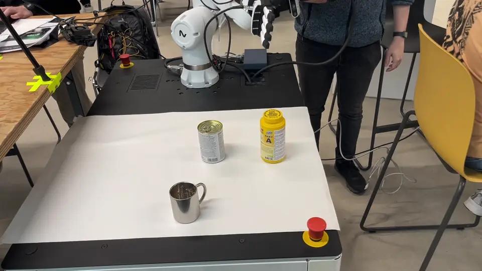
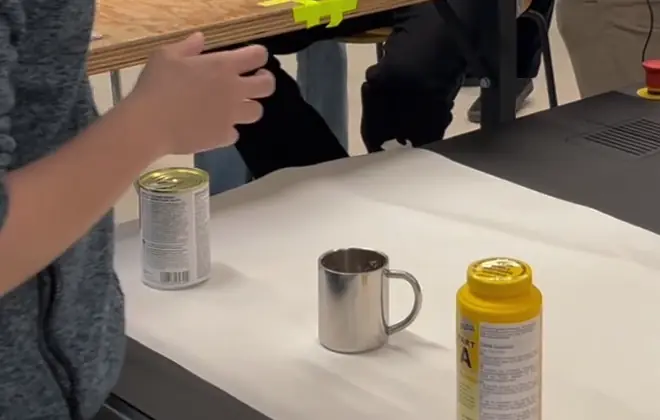
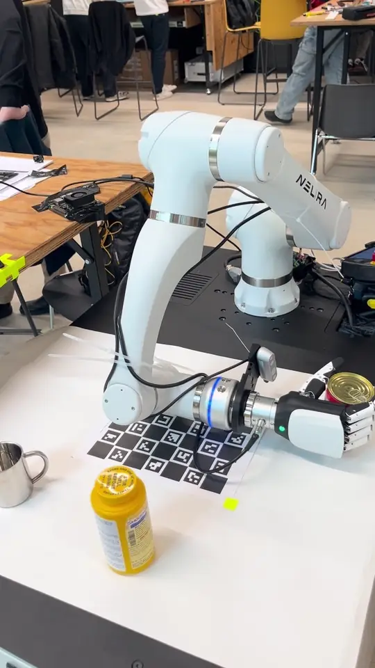
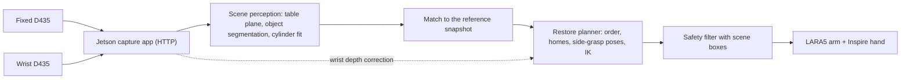
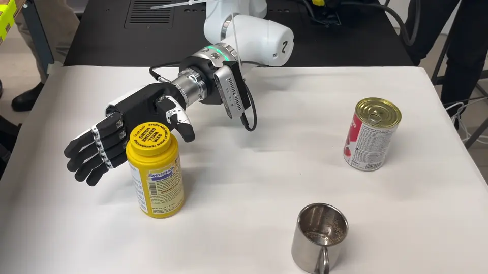

# Dexterous Pick & Place: a robot arm that puts things back

[](https://github.com/esenoguzhan/dexterous_pick_place/actions/workflows/tests.yml)



Someone shuffles the objects on a table while the robot's camera is covered. When the camera is
uncovered, the robot compares the table with a reference snapshot, works out which objects moved,
and puts each one back: it approaches from the side with a five-finger Inspire hand, corrects
its approach with a wrist depth camera, lifts the object over the others, places it and checks the
result.

We built it as a team of four during a robotics hackathon in October 2026, on a NEURA Robotics
LARA5 arm with an Inspire RH56 dexterous hand, two Intel RealSense D435 cameras and an NVIDIA Jetson.

## Results on the real robot

| Run | Result |
|---|---|
| One can moved 16 cm by hand | Recognised, side-grasped, carried over the other objects, placed **22 mm** from its home (tolerance 25 mm). The objects that had not moved were left alone. |
| Can and bottle moved together | Both put back in one run, **5 mm** and **8 mm** from home. |
| Planning time | **5–10 s** per object after replacing finite-difference IK through a ROS service with IK on the URDF chain (40–60 s before). |

## Videos

Real runs on the robot. The previews are sped up; each is one uncut camera shot.

**The shuffle** (2× speed). A teammate moves the bottle, the can and the mug from where they
started.



**Bottle, the whole restore** (4× speed, at the top of this page). The same run, right after the
shuffle: approach, side grasp, lift, carry over the other objects, place and release. The
recording stops after the bottle, and the mug is too short for the side grasp (see [Limits](#limits)).

<!-- Full video: in GitHub's editor, drag web_videos/bottle_restore_fixed_camera_720p.mp4 onto this line. -->

**Red can** (4× speed). The arm reaches past the calibration board, grasps the can from the side,
carries it and puts it down at its place.



<!-- Full video: drag web_videos/can_restore_portrait_720p.mp4 onto this line. -->

A close-up of the grasp is under [How it works](#how-it-works).

## Limits

What did not work, or only partly:

- **Short objects** (a 75 mm mug, a 40 mm tape roll) cannot be side-grasped, because the wrist camera
  hangs below the hand. They are reported as not restored and treated as obstacles.
- **Robustness of the setup**: three computers on a phone hotspot, a Jetson whose USB network
  sometimes did not come up, and an arm that stops following after about 12 idle minutes. The demo
  script checks for each of these and says what to do.
- **The SAM 2.1 + DINOv2 perception** ran on the Jetson test bench and in simulation. The real-robot
  loop used a simpler, more reliable pipeline (white sheet, table refit, cylinder-axis fit).

## How it works



1. **Reference.** The fixed camera sees the table and every object on it (pose, size, colour) and
   stores that as the reference.
2. **Change detection.** After the scene is shuffled, a new snapshot is matched to the reference
   by colour histogram, height and radius. Objects that moved more than the tolerance are queued.
3. **Grasp planning.** For each moved object, a side grasp is planned: the hand heading, a pregrasp
   clear of the other objects (which are boxes in the safety filter), and numeric IK.
4. **Wrist correction.** Near the object, the wrist camera measures the object's axis. The approach
   is corrected and re-checked, and re-planned if the corrected approach is refused.
5. **Grasp, carry, place.** The thumb is turned into opposition first. Then the fingers and thumb
   close together, the object is lifted 20 cm, carried and placed. The place pose is corrected for
   the object's measured shift in the hand. The scene is perceived again after every place.

Step 5 up close (2× speed): the open hand reaches the bottle from the side with the thumb already
in opposition, the fingers and thumb close around it, and the arm lifts it.



<!-- Full video: drag web_videos/bottle_restore_720p.mp4 onto this line. -->

The same task also exists as a full ROS 2 stack (`src/restore`): a scene-perception node with a
`CaptureScene` service and a `Restore` action server that diffs snapshots, orders the moves and
drives the arm. That stack has been tested in MuJoCo and against a fake robot.

## Repository layout

| Path | What it is |
|---|---|
| [`tools/restore_physical`](tools/restore_physical) | The code that ran on the real arm in the video: perception client, object matching, side grasp, IK, `restore.py` and the one-command `demo.sh` |
| [`src/restore/restore_perception`](src/restore/restore_perception) | Multi-camera RGB-D scene perception without ROS in `core/` (segmentation, fusion, geometry, gallery labels with DINOv2), plus a ROS 2 node and offline and simulation evaluations |
| [`src/restore/restore_task`](src/restore/restore_task) | The `Restore` action: snapshot diff, move ordering, grasp poses and hand checks, plus the ROS 2 orchestrator node |
| [`src/restore/restore_interfaces`](src/restore/restore_interfaces) | `SceneSnapshot`, `ObjectState`, `CaptureScene`, `RegisterObject`, `Restore` |
| [`src/robot/lara5_object_approach`](src/robot/lara5_object_approach) | Two-phase approach to an object pose, with a 30 cm aligned pregrasp and measured completion checks |
| [`src/robot/lara5_grasp`](src/robot/lara5_grasp) | Contact-limited hand closure with force evidence |
| [`src/robot/lara5_object_lift`](src/robot/lara5_object_lift) | Verified lift: a 4 cm test, then 10 cm if the object follows |
| [`src/robot/lara5_wrist_grasp`](src/robot/lara5_wrist_grasp) | Wrist-camera object selection, tracked approach and an exclusive approach-to-closure handoff |
| [`src/robot/lara5_sim_approach`](src/robot/lara5_sim_approach) | Camera-guided approach and pick-and-place in MuJoCo |
| [`src/robot/lara5_grasp_bringup`](src/robot/lara5_grasp_bringup) | One launch for simulated approach, grasp and lift |
| `src/robot/lara5_mujoco_sim`, `lara5_inspire_hand_description`, `lara5_safety_msgs`, … | Our additions to NEURA's packages: simulated D435s, a CAD wrist-camera holder, grasp feedback, ground truth and services. The base packages are not included. |
| [`wendy/perception_test`](wendy/perception_test) | Jetson test bench: SAM 2.1 segmentation, DINOv2 embeddings, camera-to-robot calibration, served over HTTP |
| [`ws/src/neurahackathon_cameras`](ws/src/neurahackathon_cameras) | Dual-D435 ROS 2 launch and stream settings |
| [`docs/`](docs) | The design notes and test reports we wrote during the hackathon |

Good starting points in `docs/`:
[perception architecture](docs/perception_architecture.md),
[task architecture](docs/task_architecture.md),
[deployment across arm, PC and Jetson](docs/deployment.md),
[where the real-robot work ended](docs/restore_physical_handoff.md),
[perception scored against MuJoCo ground truth](docs/perception_simulation_eval.md) and
[the CAD wrist-camera holder](docs/wrist_camera_holder.md).

## What is not in this repository

NEURA Robotics' source code is not included in this repository. Our ROS 2 packages build on
NEURA's LARA5 workspace, so they do not build from this repository alone, and many commands in
`docs/` use an image (`lara5_hackathon`) built from it.

The RealSense ROS driver is fetched from upstream at a pinned commit instead of being vendored
(see [`docs/camera_workspace.md`](docs/camera_workspace.md)).

## Running the tests

The perception, task and calibration logic is plain Python and is tested without ROS or hardware:

```bash
pip install numpy scipy pyyaml "opencv-python-headless==4.10.0.84" pillow pytest
pytest src/restore/restore_perception/test
pytest src/restore/restore_task/test        # the fake-robot node test needs rclpy and is skipped without it
pytest wendy/perception_test/tests
```

## What we would do differently

- **Test on the real robot from day one.** Our simulation had a joint offset, the replacement hand
  mounted differently and no camera table. Each of these cost time once on the real arm.
- **Keep one source of truth.** Configuration and code changes made directly on the robot PC were
  hard to track. Masks left over from earlier runs hid objects.
- **Make the infrastructure boring.** Fewer computers, wired links and a health check before every
  run. Our `demo.sh` ended up doing exactly that.

## Acknowledgements

Thanks to NEURA Robotics for the LARA5 arm, the Inspire hand and the base workspace.

## License

[Apache-2.0](LICENSE) for the code in this repository.
