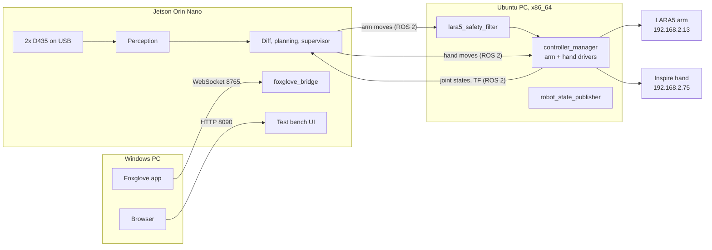

# Deployment

> **Status: proposal.** This describes where each part of the system runs. IP addresses marked
> "proposed" are suggestions; the arm and hand addresses come from `src/README.md`.

## 1. Overview

Three computers share the robot network:

- The **Ubuntu PC** runs the existing robot stack, unchanged.
- The **Jetson** runs the cameras and everything we build.
- The **Windows PC** only connects and visualises.

## 2. Machines

| Machine | Runs | Why there |
|---|---|---|
| **Ubuntu PC** (x86_64, Ubuntu 22.04, Docker) | `controller_manager.launch.py` as it is: `robot_state_publisher`, the controller manager with the arm driver (`neura_driver`) and the hand driver (`inspire_dftp_e2`), the arm and hand controllers, `lara5_safety_filter`, and MuJoCo in simulation mode | `neura_driver` needs `neura_cpp_api`, which NEURA ships only for x86_64. The safety filter needs NEURA's `robot_model` and `inverse_kinematics`, also x86_64 only. The hand driver is a plugin in the same controller manager, so it runs here too; it reaches the hand over Modbus TCP, so its location does not matter. |
| **Jetson Orin Nano** | Both D435 cameras, perception, the orchestrator (scene diff, task and grasp planning, the supervisor; see [`task_architecture.md`](task_architecture.md)), camera calibration, `foxglove_bridge`, the perception test bench | It has the GPU for SAM 2.1 and DINOv2, and the cameras are plugged into it. |
| **Windows PC** | Foxglove desktop app, a browser for the test bench, SSH, the `wendy` CLI and Docker Desktop for building Jetson images | Connection and visualisation only. No ROS: the robot stack does not support Windows or WSL. |

### Simulation runs on the Ubuntu PC too

In simulation the Ubuntu PC runs the same launch file with `deployment_mode:=simulation`. The safety
filter only runs on x86_64, and it provides the Cartesian `MoveToPose` action in simulation as
well. Keeping the simulation next to it means the Jetson sees exactly the same interface in simulation
and on the robot.

The [trajectory prototype](../src/robot/lara5_sim_approach/README.md) now provides
one fixed external RGB-D camera in `lara5_mujoco_sim`, with topics under
`/sim/external_camera/`. The proposed dual-camera topic adapter remains future
work. See section 3.2 of
[`perception_architecture.md`](perception_architecture.md).

## 3. Network

All machines connect to one switch on the robot subnet `192.168.2.0/24`.

| Device | Address | Notes |
|---|---|---|
| LARA5 control box | `192.168.2.13` | Fixed by the robot |
| Inspire hand | `192.168.2.75` | The `hand_ip` default; set the hand to it with `update_hand_ip` (see `src/README.md`) |
| Ubuntu PC | `192.168.2.100` (proposed) | The address `src/README.md` suggests for the robot PC |
| Jetson | `192.168.2.101` (proposed) | The Orin Nano developer kit has one Ethernet port; use it for this switch |
| Windows PC | `192.168.2.102` (proposed) | |

- **ROS domain:** set the same `ROS_DOMAIN_ID` (your team number) on the Jetson and the Ubuntu PC.
- **Host networking:** run the containers on both Linux machines with host networking, so DDS
  discovery works between them.
- **Internet:** if the Jetson needs internet access, give it a separate link such as Wi-Fi rather
  than a second router on the robot subnet.
- **Windows firewall:** the Windows PC only opens outgoing connections to the Jetson: TCP 8765 for
  Foxglove and TCP 8090 for the test bench.

## 4. ROS 2 interfaces across the network

| Interface | Type | From | To |
|---|---|---|---|
| `/joint_states` | `sensor_msgs/JointState` | Ubuntu PC | Jetson |
| `/tf`, `/tf_static` (robot links) | `tf2_msgs/TFMessage` | Ubuntu PC | Jetson |
| `/robot_description` | `std_msgs/String` | Ubuntu PC | Jetson |
| `/safety/arm/move_to_pose` | Action `lara5_safety_msgs/MoveToPose` | Jetson (client) | Ubuntu PC (server) |
| `/arm_trajectory_controller/follow_joint_trajectory` | Action, served by the safety filter | Jetson (client) | Ubuntu PC |
| `/hand_controller/follow_joint_trajectory` | Action `control_msgs/FollowJointTrajectory` | Jetson (client) | Ubuntu PC |
| `/safety/status` | Rejection reasons | Ubuntu PC | Jetson |
| `/tf_static` (cameras) | `world` to `camera_N_color_optical_frame` | Jetson | Ubuntu PC, Foxglove |
| `/perception/snapshot`, `/perception/markers` | Perception output | Jetson | Foxglove |
| `/cameras/camera_N/...` (simulation only) | Simulated colour, depth and camera info | Ubuntu PC | Jetson |

The real cameras are not published as ROS image streams. Perception reads them directly on the
Jetson, so camera images never cross the network on the robot.

**Camera calibration** uses HTTP until the Jetson runs ROS: `calibrate_cameras.py` on the Ubuntu PC
reads the flange pose from TF and posts it to `http://<jetson>:8090/api/calib/sample`. See section 3.4
of [`perception_architecture.md`](perception_architecture.md).

## 5. Software on each machine

### 5.1 Ubuntu PC

- The existing robot image, built from `src/docker/Dockerfile`, run with
  `--net=host --ipc=host` and the real-time options described in `src/README.md`.
- Launch with `deployment_mode:=robot`, or `deployment_mode:=simulation` for development.
- **Obstacles:** add the fixed camera's mount to `lara5_safety_filter/config/obstacles.yaml`, and the
  hand camera to the hand's collision geometry in the URDF, so the safety filter keeps them clear.
- The RealSense container in [`compose.realsense.yaml`](../compose.realsense.yaml) is not used here,
  because the cameras are on the Jetson.

### 5.2 Jetson

One Wendy app, `restore`, holds all our code in a single container image:

- `ubuntu:22.04` (arm64) with `ros-humble-ros-base` and `ros-humble-foxglove-bridge` from apt
- the CUDA, PyTorch, SAM 2.1, DINOv2 and `pyrealsense2` setup from
  [`wendy/perception_test/build.stagefile.yaml`](../wendy/perception_test/build.stagefile.yaml),
  including the NumPy 1.26.4 pin
- our ROS 2 packages from `src/restore/`, built with `colcon`
- entitlements: host network, GPU, USB, camera, the `/data` volume for the gallery, snapshots and
  calibration, and HTTP ports 8090 and 8765

A single launch file inside the container starts perception, the diff, planning, the supervisor and
`foxglove_bridge`. Keeping everything in one container avoids DDS set-up between containers on the
Jetson.

**Only one program can open a camera.** Stop the `perception_test` app before starting `restore`,
and the other way round.

**Resources:** use the 25 W power mode. The Orin Nano shares 8 GB between CPU and GPU, and the two
models need a few GB of it. The real-time controller loop runs on the Ubuntu PC, so perception load on
the Jetson cannot disturb it.

### 5.3 Windows PC

- **Foxglove desktop app:** connect to `ws://192.168.2.101:8765`. Use the desktop app rather than the
  web app, because browsers block a `ws://` connection from an `https://` page.
- **Browser:** the test bench at `http://<jetson>.local:8090`.
- **Docker Desktop and the `wendy` CLI:** build and deploy the Jetson app. Builds run under ARM
  emulation; see [`wendy/perception_test/README.md`](../wendy/perception_test/README.md) for two
  workarounds.

## 6. Clock synchronisation

Run `chrony` on the host of both Linux machines, with the Ubuntu PC as the server and the Jetson as its
client. TF lookups and joint-state timestamps then agree across the two machines.

The capture guard on the Jetson judges `/joint_states` freshness by its arrival time, not by its
header stamp, so a clock offset cannot block captures.

## 7. Bring-up order

1. **Robot:** power on and apply the robot GUI settings from `src/README.md` (section 5.2 there).
2. **Ubuntu PC:** check `ping 192.168.2.13` and `ping 192.168.2.75`, start the robot container, and
   launch with `deployment_mode:=robot`. Check with `ros2 control list_controllers`.
3. **Jetson:** check that `ros2 topic list` shows `/joint_states` from the Ubuntu PC, then start the
   `restore` app.
4. **Windows PC:** connect Foxglove and check the TF tree: robot links from the Ubuntu PC and camera
   frames from the Jetson.
5. **Calibration:** recalibrate the cameras if a camera was moved or the change mask reports a bump:
   run `calibrate_cameras.py` on the Ubuntu PC and watch `http://<jetson>:8090/calibration` (see
   [`wendy/perception_test/README.md`](../wendy/perception_test/README.md#camera-calibration)).

## 8. Open questions

- **NEURA ARM builds:** does NEURA have aarch64 builds of `neura_cpp_api` 2.0.2 and of the kinematics
  packages? With them, the robot stack could move to the Jetson and the Ubuntu PC could be dropped.
- **Hardware:** does the hackathon provide the Ubuntu PC, or does the team bring one?
- **Jetson internet:** does the Jetson have internet at the venue for deployments, or does
  everything have to be baked into the image beforehand?
