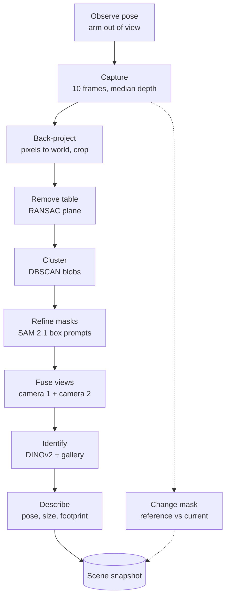

# Perception architecture

> **Status: proposal.** Nothing in this document is implemented yet. All parameter values are
> starting points to tune in simulation and on the real cameras.

## 1. Purpose

Perception turns the two RealSense D435 cameras into a **scene snapshot**: a list of the objects on
the table, each with its identity, pose in the `world` frame, size, footprint, point cloud and
appearance fingerprint.

The rest of the system only consumes snapshots:

| Consumer | Uses from the snapshot |
|---|---|
| Scene diff | Identity, DINOv2 embedding, pose, point cloud, symmetry |
| Task planner | Footprint polygon, support relation (what an object rests on) |
| Grasp planner | Size, shape and grasp primitive (from `objects.yaml`) |
| Supervisor | The capture service, called for the reference, the current scene and after every placement |

## 2. Design principles

1. **Snapshots, not tracking.** The scene is captured at a few moments only: the tidy reference,
   the disturbed scene, and after each placement. A capture may take 1 to 3 seconds, so accuracy
   wins over speed.
2. **Geometry first, models second.** A table-plane fit plus clustering finds any object that
   sticks up from the table, with no training. SAM 2.1 then refines outlines and DINOv2 identifies
   objects.
3. **Known objects, generic fallback.** The eight hackathon objects are registered in a gallery
   with their sizes, symmetries and grasps. An object that matches nothing still gets a pose and a
   fingerprint and goes through the generic path.
4. **Relative measurement.** The same cameras measure the reference and the current scene, so a
   constant calibration offset largely cancels out in the displacement the robot executes.
5. **Same interface in simulation and on the robot.** Simulated MuJoCo cameras publish the same
   topics and frame names as the real D435s.
6. **ROS-free core.** The algorithms live in plain Python modules with a thin ROS 2 node on top, so
   the same code runs offline on saved captures and in tests.

## 3. Inputs

### 3.1 Cameras

Two fixed D435 cameras looking at the table (eye-to-hand). Mounting guidelines:

- Angle both cameras roughly 30 to 60 degrees from vertical. Looking straight down at a can lid
  reflects the camera's own infrared pattern back and destroys the depth on metal.
- Keep every object at least 0.3 m from the camera (D435 minimum range at 848x480). About 0.6 to
  1.0 m from the table centre works well.
- Place the cameras on different sides of the table so each one sees what the other cannot.
- Use rigid mounts. A bumped camera invalidates the calibration (the change mask in section 6 detects it).

### 3.2 Topics

Per camera `N` in {1, 2}, from [`dual_realsense.launch.py`](../ws/src/neurahackathon_cameras/launch/dual_realsense.launch.py):

| Topic | Type | Notes |
|---|---|---|
| `/cameras/camera_N/color/image_raw` | `sensor_msgs/Image` | `rgb8` |
| `/cameras/camera_N/aligned_depth_to_color/image_raw` | `sensor_msgs/Image` | `16UC1`, millimetres, on the colour pixel grid |
| `/cameras/camera_N/color/camera_info` | `sensor_msgs/CameraInfo` | Intrinsics `fx, fy, cx, cy` |
| `/tf_static` | `tf2_msgs/TFMessage` | `world` to `camera_N_link`, from calibration |

### 3.3 Driver settings

Changes to [`streams.yaml`](../ws/src/neurahackathon_cameras/config/streams.yaml) for perception:

```yaml
rgb_camera.color_profile: "1280x720x30"  # was 640x480: more pixels on small objects
align_depth.enable: true                 # was false: one depth value per colour pixel
enable_sync: true                        # was false
spatial_filter.enable: true              # edge-preserving smoothing
temporal_filter.enable: true             # averages depth over frames
depth_module.laser_power: 250.0          # raise towards the D435 maximum (360) if the black mouse has holes
enable_infra1: false                     # perception does not use the infrared images;
enable_infra2: false                     # disabling them saves USB bandwidth
```

Depth stays at 848x480, the D435's most accurate depth resolution, and is upsampled onto the colour
grid by the alignment.

### 3.4 Calibration

Perception only looks up `world` to `camera_N_color_optical_frame` through TF. Producing that
transform (hand-eye calibration with `easy_handeye2` and `aruco_ros`) is a separate module.

## 4. Pipeline overview



| Stage | Technique | Main package | Needs training |
|---|---|---|---|
| Observe pose | Fixed joint configuration | Supervisor + `ros2_control` | No |
| Capture | Synchronised frames, per-pixel median | `message_filters`, NumPy | No |
| Back-project | Pinhole model + TF | NumPy, `tf2_ros` | No |
| Remove table | RANSAC plane fit | Open3D | No |
| Cluster | DBSCAN | Open3D | No |
| Refine masks | Box- and point-prompted segmentation | SAM 2.1 (`facebook/sam2.1-hiera-small`) | No |
| Fuse views | 3D association + outlier removal | Open3D, SciPy | No |
| Identify | Embedding nearest neighbour against a gallery | DINOv2 (`facebook/dinov2-small`) via `transformers` | No (gallery registration only) |
| Describe | Footprint rectangle on the table plane | OpenCV, Shapely | No |

## 5. Stages

### 5.0 Observe pose

- **Method:** the supervisor moves the arm to a fixed `observe` joint configuration, chosen once so
  the arm is outside both camera views, and waits until joint speeds are near zero plus 0.5 s.
- **Guard:** the capture service checks `/joint_states` and refuses to capture when the arm is not
  at the observe pose (parameter `require_observe_pose`).
- **Why:** the arm would otherwise be clustered as an object and would hide objects behind it.
- **Later option:** a robot self-filter that renders the URDF into each depth image and masks the
  arm, so captures work with the arm in view.

### 5.1 Capture

- **Method:** keep a ring buffer of the last synchronised frames per camera
  (`ApproximateTimeSynchronizer` on colour, aligned depth and camera info). On request, take the
  last 10 frames and compute the per-pixel median depth, ignoring zeros. A pixel is valid when at
  least half of its samples are valid. Colour is the newest frame.
- **Output per camera:** colour image, depth in metres, intrinsics, frame id, timestamp.
- **Why:** D435 depth flickers at object edges and drops pixels. The median removes most of that,
  which keeps object centres stable between captures.

### 5.2 Back-project to the world frame

- **Method:** for each valid pixel `(u, v)` with depth `Z`:
  `X = (u - cx) * Z / fx`, `Y = (v - cy) * Z / fy`. Transform the points with the TF from the
  camera optical frame to `world`, then crop to the workspace box.
- **Keep:** the source `(camera, v, u)` of every point, so 2D masks can select 3D points and 3D
  blobs can be projected back into the images.
- **Workspace box (simulation):** x from -0.6 to 0.6, y from -0.4 to 0.4, z from 0.88 to 1.30 m
  (see [`mujoco_sim.yaml`](../src/robot/lara5_mujoco_sim/config/mujoco_sim.yaml)). Measure the real
  table and set the same parameters for the robot.

### 5.3 Remove the table

- **Method:** voxel-downsample to 5 mm, then `segment_plane(distance_threshold=0.008, ransac_n=3,
  num_iterations=1000)`. Keep points more than 0.01 m above the plane.
- **Checks:** the plane normal must be within 10 degrees of world up, and the table height must
  match the previous capture within 0.01 m. Otherwise report "table not found or camera moved".
- **Output:** plane coefficients, table height, the above-table point cloud.
- **Why:** anything resting on a table sticks out of its plane, whatever the object is. A new table
  only needs a new plane fit. The plane also provides the true "up" direction and the surface used
  for placing objects and for objects with bad depth.

### 5.4 Cluster into object candidates

- **Method:** `cluster_dbscan(eps=0.015, min_points=30)` on the above-table points. Drop clusters
  with fewer than 50 points, an extent above 0.30 m, or a height under 0.015 m.
- **Output:** candidates, each with its 3D points and a padded 2D box (10 px) per camera, obtained
  by projecting the points into that image.
- **Known weaknesses, handled in 5.5:** touching objects merge into one cluster; flat, shiny or
  transparent objects may have too few depth points to form a cluster.

### 5.5 Refine masks with SAM 2.1

- **Method:** per camera, call `SAM2ImagePredictor.set_image` once, then `predict(box=...,
  multimask_output=True)` for each candidate visible in that camera. Choose the output mask that
  best covers the candidate's projected pixels.
- **Mask to points:** an object's points are the points whose source pixel is inside the mask and
  that lie at least 0.005 m above the table. This removes table bleed and shadows at the edges.
- **Splitting touching objects:** if the chosen mask covers less than 70 % of the candidate's
  projected pixels, the cluster probably holds more than one object. Prompt SAM again with a point
  at the centre of the uncovered pixels, and split the cluster by mask membership. Repeat until
  coverage is reached or no new mask appears.
- **Objects with bad depth:** run `SAM2AutomaticMaskGenerator` on the workspace part of the image.
  A mask of plausible size that overlaps no candidate becomes a depth-poor candidate. Its footprint
  comes from intersecting the rays of the mask's lower-edge pixels with the table plane, and its
  height comes from the gallery once it is identified (5.7).
- **Why SAM:** it outlines objects it has never seen, it follows the prompt, so it never has to
  guess which object is meant, and it works on colour, where depth fails (the steel mug, can lids).

### 5.6 Fuse the two camera views

- **Method:** associate per-camera objects with the Hungarian algorithm on 3D centroid distance,
  accepting pairs within 0.02 m or with a voxel overlap (IoU) of at least 0.3. Merge the points of
  each pair, then `remove_statistical_outlier(nb_neighbors=20, std_ratio=2.0)`.
- **Objects seen by one camera** are kept and marked in `cameras_seen`.
- **Why:** one camera sees the front of an object and the other its back. The fuller shape gives a
  better centre, a better footprint and a better ICP alignment in the scene diff.

### 5.7 Identify with DINOv2 and the gallery

- **Embedding:** per camera, crop the mask's bounding box with 10 % padding, set the background
  outside the mask to grey (127), resize to 224x224 and run DINOv2. Take the CLS token (384 values
  for the small model) and L2-normalise. Average over the cameras that saw the object and normalise
  again.
- **Gallery score:** for each gallery object, the highest cosine similarity between the detection
  and any of that object's stored views.
- **Assignment:** all eight objects are different, so each gallery object can be used at most once.
  Solve detections against gallery objects with the Hungarian algorithm on `1 - score`.
- **Acceptance:** accept a match when the score is at least 0.6, the margin over the second-best
  object is at least 0.05, and the measured size fits the gallery size within 30 % per dimension
  (any axis order, because an object may lie on a different side). Otherwise the label is `unknown`.
- **Tie-break:** an HSV colour histogram of the masked pixels, compared with the gallery views.
- **Why DINOv2:** its features recognise the same object across viewpoint and lighting changes
  without training, and they separate objects of similar colour.

### 5.8 Describe each object

- **Footprint:** project the object's points onto the table plane and take `cv2.minAreaRect`. This
  gives the centre `(x, y)`, length, width and yaw about the table normal. The footprint polygon is
  stored for the planner.
- **Height:** the 95th percentile of the point heights above the table.
- **Pose:** position at the footprint centre with `z = table height + height / 2`, orientation as
  the yaw about the table normal.
- **Yaw ambiguity:** a rectangle's yaw is only defined modulo 180 degrees (90 for a square). The
  full orientation of asymmetric objects (mouse, mug handle, bottle cap) is resolved in the scene
  diff, by ICP of the current cloud against the reference cloud.
- **Known-size fallback:** when `depth_reliable` is false for the object, or it has too few points,
  fit a rectangle of the gallery size to the mask-derived footprint instead.
- **Which side is up:** gallery views are tagged with the side facing up (for example the sponge's
  yellow or dark side). The best-matching view's tag gives the side.
- **Support:** an object whose bottom is more than 0.015 m above the table and whose footprint
  overlaps another object's footprint rests on that object. Otherwise it rests on `table`.
- **Confidence:** combines the SAM score, the gallery score, the point count and the number of
  cameras that saw the object.

## 6. Change mask

The cameras do not move, so the reference and current images can be compared pixel by pixel.

- **Method:** a pixel has changed when its depth differs by more than 0.01 m, or its colour differs
  by more than a threshold in Lab space. Clean up with a morphological opening and drop regions
  under 200 px.
- **Uses:**
  - An object whose pixels did not change has not moved. The scene diff skips it, which prevents
    false "moved" detections caused by noise.
  - A changed region that contains no detected object can be a person's hand still in the scene:
    wait and capture again.
  - If most of the image changed, the camera was probably bumped: warn and request recalibration.

## 7. Object gallery and `objects.yaml`

### 7.1 Registration

1. Clear the table and place one object on it.
2. Call `/perception/register_object` with the object's name.
3. Rotate the object by hand in steps of about 30 degrees, calling the service for each view, for
   10 to 20 views. Register every resting side that can occur (for the sponge, both sides up).
4. The pipeline runs stages 5.1 to 5.6, expects exactly one object, and stores its crops,
   embeddings, colour histogram and measured size under `gallery/<name>/`.

### 7.2 Per-object configuration

Sizes below are estimates from a photo. Measure the real objects and replace them.

```yaml
# config/objects.yaml
# size_m: [length, width, height] as the object rests in the reference scene
# symmetry: yaw symmetry about the table normal
#   none          every yaw is distinct
#   continuous    yaw does not matter (round, upright)
#   n: <k>        k-fold (2 = 180 degrees, 4 = 90 degrees)
objects:
  tuna_can:
    size_m: [0.085, 0.085, 0.040]
    shape: cylinder_upright
    symmetry: continuous
    grasp: wrap_top
    rolls: false
    depth_reliable: false     # shiny lid
  yellow_bottle:
    size_m: [0.140, 0.090, 0.090]
    shape: cylinder_lying
    symmetry: none            # cap end is distinct
    grasp: wrap_wide
    rolls: true
    depth_reliable: true
    mass_kg: 0.5
  mouse:
    size_m: [0.115, 0.075, 0.045]
    shape: irregular
    symmetry: none
    grasp: wrap_top
    rolls: false
    depth_reliable: true      # black plastic: watch for holes
  steel_mug:
    size_m: [0.110, 0.080, 0.080]   # length includes the handle
    shape: cylinder_upright
    symmetry: none            # handle direction
    grasp: wrap_body
    rolls: false
    depth_reliable: false     # mirror-like metal
  soup_can:
    size_m: [0.110, 0.073, 0.073]
    shape: cylinder_lying
    symmetry: {n: 2}
    grasp: wrap_top
    rolls: true
    depth_reliable: true      # lids are shiny, the label is not
  sponge:
    size_m: [0.090, 0.060, 0.045]
    shape: box
    symmetry: {n: 2}
    up_side_matters: true     # yellow or dark side up
    grasp: pinch_wide
    rolls: false
    depth_reliable: true
  wooden_cube:
    size_m: [0.055, 0.055, 0.055]
    shape: box
    symmetry: {n: 4}
    grasp: pinch_wide
    rolls: false
    depth_reliable: true
  wooden_egg:
    size_m: [0.060, 0.045, 0.045]
    shape: ellipsoid_lying
    symmetry: {n: 2}
    grasp: tripod_top
    rolls: true
    depth_reliable: true
```

### 7.3 Object-specific risks

| Object | Perception risk | Handling |
|---|---|---|
| Steel mug | Mirror-like surface: bad depth, appearance changes with the room | Angled cameras, SAM mask on colour, known-size fallback, several gallery views under venue lighting |
| Tuna can, soup can lids | Specular lids | Angled cameras; the can bodies give good depth |
| Mouse | Black plastic can return weak depth | Higher laser power, median over 10 frames |
| Wooden cube, wooden egg | Same colour as the wooden table | Found by height above the table, not by colour; SAM prompted with the 3D box |
| Sponge | Two colours, deformable | Side-up tags in the gallery |
| Touching pairs (cube and egg, sponge and soup can, mug and soup can) | Merged into one cluster | SAM split (5.5) and the gallery size check (5.7) |
| Bottle, soup can, egg | Roll when placed | Not a perception issue; flagged with `rolls: true` for the motion module |

## 8. Interfaces

### 8.1 Messages (package `restore_interfaces`)

`ObjectState.msg`

```text
uint8 SYM_CONTINUOUS=0
uint8 SYM_NONE=1

string id                          # unique within a snapshot, e.g. "obj_03"
string label                       # gallery name, or "unknown"
float32 label_score                # gallery similarity
geometry_msgs/Pose pose            # world frame; yaw about the table normal
geometry_msgs/Vector3 size         # length, width, height [m]
geometry_msgs/Point[] footprint    # polygon on the table plane, world frame
uint8 symmetry                     # SYM_CONTINUOUS, SYM_NONE, or k for k-fold
bool up_side_matters
string up_side                     # gallery view tag, empty if unknown
string support_id                  # "table" or another object's id
float32[] embedding                # DINOv2, L2-normalised
sensor_msgs/PointCloud2 cloud      # world frame, downsampled to 3 mm
uint8 cameras_seen                 # bitmask: 1 = camera_1, 2 = camera_2
bool depth_reliable
float32 confidence
```

`SceneSnapshot.msg`

```text
std_msgs/Header header             # frame_id: world
string snapshot_id
float64[4] table_plane             # a, b, c, d with a*x + b*y + c*z + d = 0
ObjectState[] objects
```

`CaptureScene.srv`

```text
string name                        # e.g. "reference"; empty for an automatic id
bool save_to_disk
---
bool success
string message
SceneSnapshot snapshot
```

`RegisterObject.srv`

```text
string name
string up_side                     # optional view tag
---
bool success
string message
uint32 views_stored
```

### 8.2 Node `scene_perception_node`

| Kind | Name | Type |
|---|---|---|
| Subscribes | `/cameras/camera_N/color/image_raw`, `.../aligned_depth_to_color/image_raw`, `.../color/camera_info` | Images and camera info |
| Subscribes | `/joint_states` | Observe-pose guard |
| Service | `/perception/capture_scene` | `CaptureScene` |
| Service | `/perception/register_object` | `RegisterObject` |
| Publishes | `/perception/snapshot` | `SceneSnapshot`, transient local |
| Publishes | `/perception/markers` | `visualization_msgs/MarkerArray`: boxes, labels, footprints |
| Publishes | `/perception/debug/camera_N/overlay` | `sensor_msgs/Image`: masks and labels drawn on colour |

Models are loaded once at start-up and warmed up with one dummy inference, so the first capture is
not slow.

### 8.3 On-disk format

```text
data/
  snapshots/<snapshot_id>/
    snapshot.json                  # everything in SceneSnapshot except clouds
    objects/<id>.ply               # per-object point cloud
    camera_N/color.png
    camera_N/depth.png             # 16-bit, millimetres
    camera_N/masks.png             # one label value per object
    camera_N/overlay.png
  gallery/<object_name>/
    view_XX.png
    embeddings.npy                 # one row per view
    histograms.npy
    meta.json                      # measured size, view tags
```

## 9. Code layout

```text
src/restore/restore_perception/          # ament_python package
  package.xml
  setup.py
  config/
    perception.yaml                       # all parameters in this document
    objects.yaml
  restore_perception/
    core/                                 # no ROS imports
      types.py                            # dataclasses: Frame, Candidate, ObjectState
      capture.py                          # median depth
      geometry.py                         # back-projection, plane, clustering, footprint
      segment.py                          # SAM 2.1 wrapper, splitting, depth-poor objects
      fuse.py                             # cross-camera association
      embed.py                            # DINOv2 wrapper
      gallery.py                          # registration, matching
      describe.py                         # pose, height, support, confidence
      change.py                           # change mask
      snapshot_io.py                      # read and write data/
    node.py                               # ROS 2 wrapper
  scripts/
    record_captures.py                    # save synchronised RGB-D from both cameras
    offline_eval.py                       # run core on saved captures, write overlays and a report
  test/
```

## 10. Software stack

| Package | Install | Used for |
|---|---|---|
| ROS 2 Humble | apt `ros-humble-desktop` | `rclpy`, `message_filters`, `cv_bridge`, `tf2_ros`, `sensor_msgs_py` |
| `realsense2_camera` 4.58.4 | Vendored in `ws/`, rebuilt on Humble | D435 driver |
| Open3D | pip `open3d` | Downsampling, plane fit, DBSCAN, outlier removal |
| SAM 2.1 | pip from `github.com/facebookresearch/sam2` | Masks |
| DINOv2 | pip `transformers` | Embeddings |
| PyTorch | pip `torch torchvision` | Runs SAM 2.1 and DINOv2 on the GPU |
| OpenCV | apt `python3-opencv` | `minAreaRect`, morphology, drawing |
| SciPy | apt `python3-scipy` | Hungarian assignment |
| Shapely | apt `python3-shapely` | Footprint polygons |

Install into a virtual environment that can still see the ROS packages:

```bash
python3 -m venv --system-site-packages ~/restore_venv
```

```bash
~/restore_venv/bin/pip install "numpy<2" open3d torch torchvision transformers "git+https://github.com/facebookresearch/sam2.git"
```

Pitfalls:

- **Keep NumPy below 2.** Humble's compiled Python packages, such as `cv_bridge`, are built
  against NumPy 1.x.
- **Check the librealsense version.** The vendored driver needs 2.58 or newer
  (`apt show ros-humble-librealsense2`). If apt is older, install `librealsense2-dev` from Intel's
  repository or use apt's `ros-humble-realsense2-camera`.
- **Use a GPU.** Both models fit in a few GB of VRAM. SAM 2.1 on a CPU is too slow for comfortable
  iteration.
- **Run one ROS distribution.** Build the camera workspace on Humble instead of bridging to Jazzy.

## 11. Validation

### 11.1 Offline test on real captures (first)

Record about 20 captures with `record_captures.py`: each object alone, and groups arranged like the
real task, including the touching pairs. Run `offline_eval.py` and inspect the overlays. This
answers three questions before any ROS integration:

1. Does SAM give a clean mask for the steel mug?
2. Does SAM split the touching pairs?
3. Does the gallery name all eight objects correctly?

### 11.2 Simulation against ground truth

The simulated cameras publish the same topics, and MuJoCo knows every object's true pose. Run the
pipeline over randomised scenes and measure position and yaw errors per object.

### 11.3 Real repeatability

Capture the same untouched scene ten times. The spread of each object's centre must be well below
the 1.5 cm "moved" threshold used by the scene diff.

### 11.4 Targets

| Metric | Target |
|---|---|
| Objects detected per capture | All 8 in at least 95 % of captures |
| Gallery naming accuracy | At least 95 % |
| Position error (simulation) | At most 1 cm |
| Yaw error, asymmetric objects (simulation, after the diff's ICP) | At most 5 degrees |
| Centre repeatability (real, standard deviation) | At most 3 mm |
| Capture time, both cameras | At most 3 s |

## 12. Fallback: RF-DETR

If the offline test shows that SAM cannot reliably segment the steel mug or split the touching
objects, add a fine-tuned RF-DETR segmentation model for the eight objects. Its training labels can
come from this pipeline: geometry and SAM give the masks on easy captures, and the gallery gives the
names. DINOv2 and the gallery stay in place for identity and for unknown objects.

## 13. Open questions

- Where can the cameras be mounted at the venue, and does the robot PC have a GPU, or does
  perception run on a separate machine?
- Will the judges stand lying objects upright (or the reverse)? That needs reorientation, which is
  outside this design.
- Will the judges add objects that are not in the gallery? The generic path handles them, but
  without names, sizes or symmetry.
- What is the lighting at the venue? Register gallery views under that lighting if possible.
