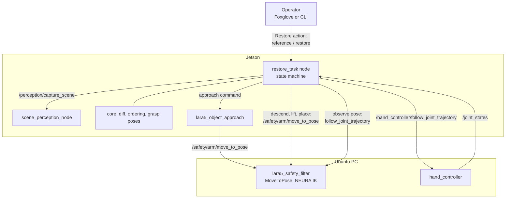
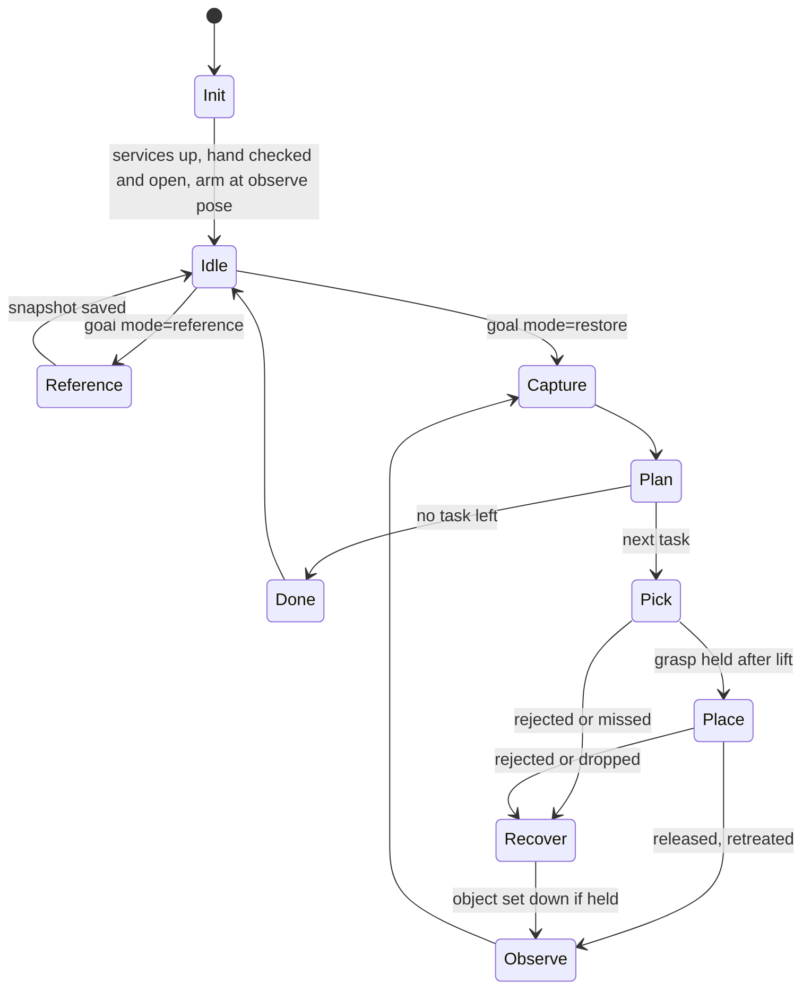

# Task architecture (orchestrator)

> **Status: implemented, not yet run on the robot.** The orchestrator is the package
> [`restore_task`](../src/restore/README.md), and the `Restore` action is in `restore_interfaces`. Its
> core is tested on hand-made scenes and on real perception snapshots. The node is tested end to end
> in a ROS 2 Humble container against a fake robot. Not yet run in simulation or on the robot. It
> works with `lara5_object_approach` (branch `feat/humble-object-approach`, not merged). The grasp
> geometry and the hand numbers are placeholders to measure (section 11). All values are starting
> points to tune in simulation and on the robot.
>
> The orchestrator runs on the Jetson next to perception; the safety filter and the controllers stay
> on the Ubuntu PC. See [`deployment.md`](deployment.md).

## 1. Purpose

Perception says where every object is ([`perception_architecture.md`](perception_architecture.md)).
`lara5_object_approach` moves the arm to one pose relative to one object. In between, something has
to decide:

- which objects were moved, and where each one belongs;
- in which order to put them back, and where to park one when two block each other;
- where the hand grasps each object and where the flange goes so the object lands on its home pose;
- the sequence of arm and hand moves, the checks between them, and what to do when one fails.

That is the orchestrator: a ROS-free core (diff, ordering, grasp geometry) and one ROS 2 node with
a state machine on top, in a new package `restore_task`.

## 2. Principles

1. **Closed loop over snapshots.** The orchestrator captures the scene, restores one object,
   captures again and plans again. A plan is never followed blindly: an object knocked over during
   the last placement shows up in the next diff.
2. **One arm client at a time.** Only the orchestrator decides what moves next. It calls
   `lara5_object_approach`, `MoveToPose` and the hand controller one after the other, never two at
   once.
3. **Pick and place share one transform.** The hand grasps the object at `T_object_flange`; the
   flange is placed at `T_world_home · T_object_flange`. Whatever the grasp, the object lands on its
   home pose, up to how much it shifted in the hand.
4. **Symmetry is resolved here.** Perception reports yaw modulo the object's symmetry. The diff,
   the grasp yaw and the place yaw all use `objects.yaml`'s symmetry, so the robot never turns a
   cube by 90 degrees for nothing.
5. **ROS-free core.** Diff, ordering and grasp geometry are plain Python on snapshots, tested
   offline on snapshots saved by perception (`data/snapshots/`), like the perception core.
6. **Fail to a safe, known state.** On any failure the arm goes back to the observe pose (with the
   object put down first if it holds one), and the orchestrator re-plans or asks the operator.

## 3. Overview



`lara5_object_approach` runs on whichever machine the team prefers; it is plain Python. The
deployment plan puts our nodes on the Jetson.

## 4. Inputs

### 4.1 Snapshots

The orchestrator calls `/perception/capture_scene` and uses these `ObjectState` fields:

| Field | Used for |
|---|---|
| `label`, `embedding` | Matching reference and current objects (5.1) |
| `pose`, `size`, `footprint` | Displacement (5.2), free space and conflicts (6), grasp height (7) |
| `symmetry`, `up_side`, `up_side_matters` | Symmetry-aware yaw (5.2), flip detection |
| `cloud` | Full orientation of asymmetric objects by ICP (5.3) |
| `support_id` | Stacks (6.2) |
| `confidence`, `depth_reliable` | Refusing to move an object perception is unsure of (5.4) |

Snapshots named `reference` are saved by perception under `data/snapshots/reference/`, with their
point clouds, so the orchestrator survives a restart between reference and restore.

**Yaw.** Perception gives yaw about the table normal; the table is level to within about a degree.
The orchestrator uses yaw about world `z` for every motion target (the object's x axis projected
onto the world xy plane), which is what `MoveToPose` and the approach node expect.

### 4.2 Object configuration

`objects.yaml` (already in `restore_perception/config`) gives size, symmetry, `rolls` and the grasp
primitive per object. The orchestrator adds the hand-side numbers per primitive in its own
`task.yaml` (section 11), so perception does not depend on them.

### 4.3 Robot state

`/joint_states` (arm and hand positions) and TF for `world` → `lara5_flange` →
`right_hand_base_link` (palm). The hand's force readings are not used (7.6).

## 5. Scene diff

Input: the reference snapshot and the current snapshot. Output: one task per moved object.

### 5.1 Matching reference and current objects

1. **Named objects:** gallery names are unique, so a label in both snapshots is a match.
2. **Unknown objects:** the Hungarian algorithm on `1 - cosine(embedding)` plus a size term
   (relative difference of the sorted sizes), accepting pairs with cosine at least 0.7 and size
   within 30 %.
3. **Left over:**
   - in the reference only: **missing** (taken away, or hidden behind something). Reported, not
     acted on;
   - in the current scene only: **new** (added by the judges, or a second copy). Reported, left
     where it is, but its footprint still counts as occupied space (6.1).

### 5.2 Displacement

For each matched pair, with `k` the yaw symmetry:

- `dxy`: distance between the footprint centres on the table.
- `dyaw`: the yaw difference wrapped to `(-pi/k, pi/k]` (k-fold), 0 for `continuous`, and wrapped to
  `(-pi, pi]` for `none` after 5.3.
- `support_changed`: `support_id` differs (an object put on top of another, or taken off).
- `flipped`: `up_side_matters` and `up_side` differs (the sponge turned over).

### 5.3 Full orientation of asymmetric objects

The footprint rectangle gives yaw modulo 180 degrees, so for `symmetry: none` (mouse, mug handle,
bottle cap) perception's `dyaw` may be off by 180 degrees. The diff aligns the current point cloud
to the reference cloud with ICP (point-to-plane, SciPy KD-tree), started twice, from `dyaw` and from
`dyaw + 180°`, about the object's centre, and keeps the start with the lower residual. A residual
gap under 20 % between the two is reported as ambiguous; the task then uses perception's yaw and is
flagged.

### 5.4 Moved or not

An object needs a task when it is matched and any of:

| Condition | Threshold |
|---|---|
| `dxy` | > 0.015 m (the perception repeatability target is 3 mm) |
| `abs(dyaw)` | > 10 degrees |
| `support_changed` | always |

and is skipped as noise when the change mask (perception section 6) says its pixels did not change
(`changed` < 0.1) while the displacement is under twice the thresholds. Tasks are refused (reported,
not executed) when:

- `flipped`: turning an object over is outside this design;
- the confidence of either snapshot's object is under 0.5, or its label changed between the two;
- the home pose or the current pose is outside the reachable table area (`task.yaml`).

### 5.5 Output

```text
Task: object id (current snapshot), reference id, label,
      current pose, home pose (both yaw about world z), dxy, dyaw,
      flags: rolls, ambiguous_yaw, support_changed
```

## 6. Task ordering

### 6.1 Conflicts

An object's **home footprint** (its reference footprint, grown by 1 cm of clearance) is **free**
when no current object other than itself overlaps it. If another object overlaps it:

- the other object also has a task: it must move first (a dependency edge);
- the other object is in its own home or is new: the home is **blocked**. That object is parked
  first (6.3), or the task is reported if parking fails.

### 6.2 Stacks

- An object resting on another in the current scene (`support_id` is not `table`) is moved before
  the object below it.
- An object that rests on another in the reference is placed after the object below it is home.

### 6.3 Order and parking

1. Build the dependency graph from 6.1 and 6.2.
2. Take the tasks with no unmet dependency; among them, the one whose current pose is nearest to
   the hand goes first (less travel).
3. If none is free (a cycle: A sits on B's home and B on A's), park one of them: move it to a
   **parking spot**, a free place on the table that overlaps no current footprint and no home
   footprint, inside the reachable area, nearest to its current pose. Its task then continues from
   the parking spot.

Only the first task of the order is executed. After it, the orchestrator captures again and
re-plans from scratch (principle 1), so the order adapts to whatever actually happened.

## 7. Grasp and place poses

### 7.1 Frames

```text
T_world_object   object centre, z = world up, x = footprint long side (yaw about world z)
T_object_tcp     where the palm frame (right_hand_base_link) sits relative to the object at grasp,
                 per primitive (7.2)
T_flange_tcp     fixed, from TF (the hand mount in the URDF)

T_world_flange_grasp = T_world_object · T_object_tcp · inverse(T_flange_tcp)
T_object_flange      = T_object_tcp · inverse(T_flange_tcp)
```

### 7.2 Primitives

The grasp primitive comes from `objects.yaml`; its geometry from `task.yaml`:

| Primitive | Objects | Approach | Palm relative to the object |
|---|---|---|---|
| `wrap_top` | tuna can, mouse, soup can (lying) | from above | over the centre, `palm_height` above the top, fingers across the narrow side |
| `wrap_wide` | yellow bottle (lying) | from above | over the centre, fingers across the bottle |
| `pinch_wide` | wooden cube, sponge | from above | thumb against index and middle across the narrow side; ring and little finger curled |
| `tripod_top` | wooden egg | from above | thumb, index and middle around the top half |
| `wrap_body` | steel mug | from the side, horizontal | at mid-height, facing the body, away from the handle |

`palm_height` and the hand shapes (7.6) are measured once per primitive on the real hand: close it
on blocks of known widths and record where the palm sits and at which finger angles the fingers stop.
That gives the width-to-angles table the squeeze targets and the grasp check use.

### 7.3 Grasp yaw

Candidate grasp yaws are the object's yaw plus every symmetric equivalent: `k` candidates for k-fold
symmetry, 12 (every 30 degrees) for `continuous`, and for `none` the yaws the primitive allows (both
directions across the narrow side; for the mug, every direction that keeps the handle out of the
palm). The candidates are sorted by how far the wrist (`lara5_joint6`) has to turn from where it is,
and tried in that order: a candidate that `MoveToPose` rejects (no IK, collision) is skipped.

### 7.4 Pick

1. **Pre-grasp:** the grasp pose moved back along the approach axis by 0.10 m (up for top grasps).
2. **Descend:** a straight `MoveToPose` line to the grasp pose, slowly (fixed duration, about 3 s).
3. **Close** the hand (7.6) and check the grasp.
4. **Lift** 0.10 m straight up, and check the grasp again (the fingers are still held open by the
   object).

### 7.5 Place

The flange goes to `T_world_home · T_object_flange`, with the **same** `T_object_flange` used for
the grasp, so the object ends up at its home pose.

- **Place yaw:** among the home yaw's symmetric equivalents, the one closest to the yaw the object
  has now, so the wrist turns as little as possible on the way.
- **Pre-place:** the place pose 0.10 m up; then a straight descent.
- **Release height:** 5 mm above the table for objects that stand; exactly at the home height for
  objects that roll (bottle, soup can, egg), so they are not dropped.
- **Release:** open to the pre-shape, slowly and with all fingers together for objects that roll;
  then retreat 0.10 m straight up, and only then open fully.

### 7.6 Hand control

**Position control only, no force sensors.** The hand's force sensors cannot be calibrated here, and
their baseline drifts, so the orchestrator neither reads nor tunes forces. Everything works from
finger positions, the same way in simulation and on the robot:

- **Pre-shape** in free space: thumb rotated to face the fingers, aperture = object width plus 2 to
  3 cm; for pinches the unused fingers curled.
- **Close to a squeeze target:** one `follow_joint_trajectory` goal over about 1 s, not to "fully
  closed" but to the finger angles of the object's width **minus a squeeze** of a few millimetres
  (per primitive, measured once: 7.2). The object stops the fingers before they reach the target; the
  remaining position error is what holds it. A small squeeze for the sponge (it gives), a larger one
  for the bottle (it is heavy).
- **Grasp check** from `/joint_states` once the goal has ended (the hand controller is open loop, so
  its "succeeded" says nothing). Each checked finger's **span** is the distance from the angle
  where it touches an object of the planned width (the width-to-angles table) to its squeeze
  target; how far short of the target it stopped is measured as a share of that span:
  - every finger within 20 % of its span from the target: nothing between them, **missed**;
  - the thumb and at least one finger at least 50 % of their span short: **held**;
  - anything else (one finger blocked by the table, for example): **unclear**, treated as missed.
- **Dropped** during transport: a held finger that closes by half its span or more has lost the
  object. The orchestrator checks the finger angles after every move with the object.
- **Risk:** the hand firmware still stops a finger when its (uncalibrated) force reading passes its
  built-in threshold. A drifted baseline can stop a finger early, in free air, which looks like
  contact. Check the hand once at the start of a session: close it empty to the pinch target and
  confirm every finger reaches it; if not, power-cycle the hand.

### 7.7 Checking the placement

After every placement the orchestrator returns to the observe pose and captures. If the object is
more than 1.5 cm or 10 degrees from home, it is picked and placed again, at most twice; then it is
reported as not restored and the next task goes on.

## 8. State machine



| State | Does | On failure |
|---|---|---|
| Init | Waits for `/perception/capture_scene`, `/safety/arm/move_to_pose`, the hand controller and the approach node; closes the empty hand to the pinch target and checks every finger reaches it (7.6); opens the hand; moves to the observe pose | Stays in Init and reports what is missing or which finger stops early |
| Reference | Observe pose, then `capture_scene(name="reference", save_to_disk=true)` | Reports; the old reference stays |
| Capture | `capture_scene` (not saved) at the observe pose | One retry, then abort to Idle |
| Plan | Diff (5), ordering (6), grasp candidates (7.3) for the first task | Nothing executable: Done with the reasons |
| Pick | Pre-shape, approach to pre-grasp, descend, close, check, lift, check (7.4) | Next grasp yaw candidate; after all of them, the task is skipped |
| Place | Approach to pre-place, descend, release, retreat (7.5) | Next place yaw candidate; else set the object down where the hand is and skip |
| Observe | Joint-space move to the observe pose through the safety filter | Abort to Idle (the arm stays where it is) |
| Recover | If holding: lower to the table straight below and release; retreat up; open the hand | Abort to Idle and ask the operator |
| Done | Final report: restored, skipped and refused objects with their errors | |

**Budgets:** two placement attempts per object (7.7), two capture retries, and an overall time
limit for the run (`task.yaml`). A cancelled goal cancels the active `MoveToPose` or approach goal
and leaves the hand as it is.

**Speed estimate:** `MoveToPose` averages 0.1 m/s, so one object takes about 30 s: observe to
pre-grasp 6 s, descend and lift 4 s, transport 4 s, descend and retreat 4 s, back to observe 3 s
(joint space), capture 3 s, hand 4 s. Eight displaced objects take about 4 minutes. If that is too
slow, the first thing to drop is the return to the observe pose after each placement: verify only
with the fixed camera when the arm is out of its view.

## 9. Interfaces

### 9.1 Action `restore_interfaces/action/Restore`

Served as `/restore/run`. One goal at a time; a cancel stops the running motion.

```text
string MODE_REFERENCE=reference
string MODE_RESTORE=restore

string mode
bool dry_run                     # plan and publish markers, move nothing
---
bool success
string message
string report_json               # per object: label, outcome, attempts, final dxy and dyaw
---
string phase                     # e.g. "pick: descend"
string object_id
string label
uint32 index                     # task number in this run
uint32 remaining                 # tasks left in the latest plan
string detail
```

`dry_run` is the first thing to try on the real robot: it captures, diffs and plans, and shows the
plan in Foxglove without moving.

### 9.2 Topics

| Topic | Type | Content |
|---|---|---|
| `/restore/plan` | `visualization_msgs/MarkerArray`, transient local | Arrows from current to home poses, task numbers, parking spots, refused objects in grey |
| `/restore/status` | `std_msgs/String`, transient local | The state and the last event, for Foxglove |

### 9.3 What the orchestrator calls

| Interface | Type | For |
|---|---|---|
| `/perception/capture_scene` | `restore_interfaces/srv/CaptureScene` | Reference, current and verification snapshots |
| `/arm/approach/target`, `/arm/approach/status` (to become an action, 10.2) | `lara5_object_approach` | Pre-grasp and pre-place |
| `/safety/arm/move_to_pose` | `lara5_safety_msgs/action/MoveToPose` | Pre-grasp, descend, lift, pre-place, place, retreat, set-down (absolute flange poses in `world`) |
| `/arm_trajectory_controller/follow_joint_trajectory` | `control_msgs/action/FollowJointTrajectory` (through the safety filter) | The observe pose |
| `/hand_controller/follow_joint_trajectory` | `control_msgs/action/FollowJointTrajectory` | Pre-shape, close, release |
| `/joint_states`, TF | | Grasp and drop checks from finger angles, wrist yaw, `T_flange_tcp` |

## 10. Using `lara5_object_approach`

### 10.1 What it does today

Given an object's centre pose in `world` on `/arm/approach/target`, it moves the flange in one
straight `MoveToPose` line to `T_world_object · T_object_flange`, with `T_object_flange` fixed at
start-up (default 0.40 m above the centre, palm down, turned with the object's yaw). It reports
`planning`, `executing`, then `succeeded` or `failed` on `/arm/approach/status` and rejects
commands while busy. It does not grasp, retry, or resolve symmetry; its README leaves object
selection and grasping to a "task coordinator". This orchestrator is that coordinator.

The parameter `pick_place.approach_mode` (or the launch argument `approach_mode`) chooses how it is
used:

- **`move_to_pose`** (default): the orchestrator computes every flange pose itself and sends them
  all to `MoveToPose`. The approach node is not needed.
- **`approach_node`**: before each pick and each place, the orchestrator sends the approach node the
  object pose, or the target pose, turned by the grasp yaw. It waits for `succeeded`, then continues
  from that hover pose with its own `MoveToPose` moves: pre-grasp or pre-place, descend, lift,
  retreat.

### 10.2 Changes requested (owner: Ercan)

1. **Accept a slightly tilted orientation.** It rejects any quaternion with `x` or `y` above 0.001.
   A pose from perception, or any computed pose, can carry a fraction of a degree of tilt. It
   should extract the yaw (or accept a tilt of about 2 degrees and drop it).
2. **Offset per command.** The orchestrator needs a different object-to-flange transform for every
   object, primitive and grasp yaw, and for pre-grasp versus pre-place. The offset (`xyz`, `rpy`)
   should come with each command instead of from a start-up parameter.
3. **An action instead of a topic and JSON status.** With a topic, the caller cannot tell which
   status event belongs to its command: the request id is made by the node and never returned. An
   action (goal = object pose, offset, duration; result = success, message, final pose; feedback =
   progress) gives correlation, cancellation and a result for free. For example
   `lara5_object_approach/action/ApproachObject`.

Until these land, the orchestrator can use the approach node only with its start-up offset, and
correlates status by sending one command at a time and taking the first `succeeded` or `failed`
after it.

### 10.3 Ownership of the arm

`lara5_object_approach` has a busy guard for its own commands, but it cannot see other clients of
`MoveToPose`. The orchestrator never sends a `MoveToPose` goal while an approach is active, and the
approach node gets no commands from anyone else while a restore runs.

## 11. Configuration

[`restore_task/config/task.yaml`](../src/restore/restore_task/config/task.yaml) lists every
parameter with a comment; a file may list only what it changes, and an unknown key is an error. The
values to measure before the first real run:

| Parameter | What to measure |
|---|---|
| `observe_joints` | The observe pose: both cameras see the table, the arm is out of their views. Same values as perception's `observe.joints` |
| `reach_area` | The table area (world xy) where the hand can reach objects from above |
| `primitives.<name>.palm_height_m` (`palm_distance_m` for side grasps) | Where the palm frame sits relative to the object at grasp |
| `primitives.<name>.tcp_rpy`, `yaws_deg` | Which way the palm frame faces, and across which object axis the thumb closes |
| `primitives.<name>.width_to_angles` | Finger angles at which the shape touches blocks of known width (at least two widths) |
| `primitives.<name>.squeeze_m`, `objects.<label>.squeeze_m` | How far past the width to close: enough to hold, small enough not to crush |

The grasp check's thresholds (`grasp_check`) are shares of each finger's span (7.6), so they carry
over when the width table changes.

## 12. Code layout

```text
src/restore/
  restore_interfaces/action/Restore.action
  restore_task/                                 # ament_python; depends on restore_perception's core
    config/task.yaml
    launch/task.launch.py
    restore_task/
      core/                                     # no ROS imports
        config.py                               # defaults, task.yaml, primitive per object
        poses.py                                # transforms, yaw about world z, Placement
        scene.py                                # snapshots from the capture service or from disk
        diff.py                                 # matching, displacement, ICP, moved or not (5)
        order.py                                # conflicts, stacks, parking (6)
        grasp.py                                # yaw candidates, pick and place poses (7)
        hand.py                                 # pre-shapes, squeeze targets, grasp and drop checks (7.6)
        report.py                               # per-object outcomes
      clients.py                                # perception, MoveToPose, approach node, arm, hand, TF
      node.py                                   # state machine, Restore action, markers
      plan_offline.py                           # diff and plan two saved snapshots, print the plan
    test/
      test_core.py                              # the core on hand-made scenes
      fake_robot.py, test_node_fake_robot.py    # the node against a fake robot (needs ROS 2)
```

`ros2 run restore_task plan_offline data/snapshots/reference data/snapshots/<current>` (or
`python3 -m restore_task.plan_offline ...`) runs the diff and the ordering on snapshots saved by
perception, without a robot. That is how the core is tried and tuned on real captures.

## 13. Validation

1. **Offline (done):** `test_core.py` checks the core on hand-made scenes:
   - matching by name, by embedding and by size;
   - symmetry-aware turns (cube, sponge, tuna can);
   - the ICP 180-degree check (mouse) and its ambiguous case;
   - the noise guard and the refusals;
   - an object on another's home, a swap cycle with parking, a stack with a blocked home;
   - grasp candidates, and place poses that put the object exactly on its home;
   - rolling objects, side grasps, neighbours;
   - squeeze targets and the grasp and drop checks.

   `plan_offline` also runs on real perception snapshots.
2. **Fake robot (done):** `test_node_fake_robot.py` runs the node in a ROS 2 Humble container
   against `fake_robot.py`, which serves perception, `MoveToPose`, the arm and hand controllers, the
   approach node, `/joint_states` and TF:
   - reference;
   - a dry run that moves nothing;
   - a restore of two objects with one refused motion and one missed grasp, both recovered;
   - an unreachable object, refused and reported;
   - a restore through the approach node.

   Objects end within 1 mm and half a degree (symmetry-aware) of home. Cancellation is not tested
   yet.
3. **Simulation:** MuJoCo with its table objects (simulated cameras are still to be added to
   `lara5_mujoco_sim`): full restore runs with random displacements.
4. **Robot, step by step:** `dry_run` first; then one object at a time; then the whole scene.

| Metric | Target |
|---|---|
| Final position error per object | ≤ 1.5 cm |
| Final yaw error (symmetry-aware) | ≤ 10 degrees |
| Objects restored when all are reachable | ≥ 7 of 8 |
| Time per object | ≤ 40 s |

## 14. Open questions

- **The table and the other objects are not obstacles.** The safety filter knows the floor and the
  robot only; with `min_distance` 0.03 m, adding the table as a box may make low grasps impossible.
  Either the table goes in with a smaller margin near the hand, or grasps stay above the table by
  design. The other objects on the table are not checked at all: approaches come from above, and
  pre-grasp poses are kept clear of neighbouring footprints (a check in `grasp.py`).
- **Grip without force sensing.** A position squeeze holds the object only as hard as the finger
  motors push against their position error, limited by the firmware's force threshold. Whether that
  carries the 0.5 kg bottle has to be tried early.
- **Object shift in the hand.** Placement assumes the object stays where it was grasped. If it
  slips, the verification capture (7.7) catches it. An in-hand pose check with the fixed camera
  could correct it before placing.
- **Hand camera refinement.** Capturing from close above the object before descending could
  improve the grasp, but the hand camera's calibration is the weaker one (1.75 px, 2.2 mm). Decide
  after the first real runs.
- **Turning objects over** (the sponge) and standing lying objects up are outside this design.
- **Judges' rules:** is a slightly moved object worse than a skipped one? That decides how
  aggressive the moved threshold and the retry budget should be.
