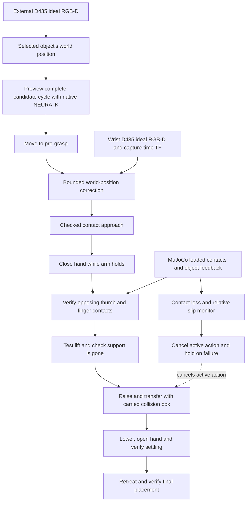

# Simulation pick and place — ROS 2 Humble / NEURA IK

The divider obstacles are removed. The table, floor, pedestal, robot and three
colored objects remain. This workflow selects an object by name, refines its
position with the wrist camera, closes the Inspire hand, checks the grasp, lifts,
transfers, releases and retreats. **It defaults to plan only.**

The red cube stays at its original starting XY `[-0.35, 0.30]`. The green cylinder
starts at `[0.25, -0.20]` and the blue ball at `[-0.50, -0.20]`, giving the first
grasp trial more room than the old tightly packed row. They remain ordinary
physical objects and collision obstacles.

The default destination is an example on the tabletop: world X = **-0.25 m**,
Y = **0.30 m**, with Z derived from tabletop height and the selected object's
height. All destination coordinates describe the **settled object centre**, not
the flange or an object's top surface. For the 5 cm red cube the default centre
is `[-0.25, 0.30, 0.925]` m, a 10 cm relocation along X.

This is an initial contact-based simulation implementation. The palm-down grasp
offset, finger angles and wrist mount are provisional, not calibrated or proven
grasp recipes. Static code/geometry tests do not establish grasp success. No
MuJoCo physics run was performed by the agent for this change. A failed physical
grasp stops the sequence; it is not converted into a successful attachment.

## What moves the object

The hand closes through `/hand_controller/follow_joint_trajectory`. Existing
MuJoCo contact forces and friction must support the object during transport.
The code does **not** teleport objects, set their qpos, or add a physical weld.

The native collision checker additionally models a grasped object as a box fixed
to the flange. That is a **planning model of the carried payload**, not an actual
physics attachment. Simulator feedback checks whether the real simulated object
stays at that transform. Slip or lost contact cancels further arm motion.

## Architecture and phases



1. **Validate input.** Require the simulation-only robot description, fresh joints,
   external and wrist RGB-D, and simulator grasp feedback. The hand must start
   open. Reject unknown object names, invalid finger angles, off-table or occupied
   destinations. Other objects are collision obstacles and stay in the scene.
2. **Preview a complete cycle.** Try four palm-down grasp yaw alternatives. For
   each, plan pre-grasp and approach, check sampled finger closing postures, model
   the carried object, plan test lift/lift/transfer/release height, check opening
   postures, and plan retreat. Reject a candidate when any phase fails. No arm or
   hand commands are sent during preview. The first complete valid candidate wins.
3. **Pre-grasp.** Move above the grasp pose using native Cartesian waypoint routing.
   The initial route keeps the selected object as an ordinary collision obstacle.
   Execution passes through the public safety-filtered arm action.
4. **Wrist refinement.** Detect the selected known-color prop in the wrist RGB-D
   image and transform it into `world` at capture time. Allow at most 3 cm difference
   from the external estimate. A missing/ambiguous object or larger disagreement
   stops before the contact approach. Replan the approach and closing sweep.
5. **Contact approach.** Permit contact between the selected object's box and
   explicit right-hand links. The arm, table, pedestal and other objects remain
   checked. Move to the provisional grasp pose at conservative speed.
6. **Close and verify.** With the arm stationary, close the six commanded hand
   joints over 3 s. Contact may prevent exact joint tracking, so controller success
   alone is insufficient. Require at least 0.35 s of loaded thumb/finger contacts
   with opposing normals before any lift. A palm-only or single-digit contact
   does not satisfy the grip check.
7. **Test lift.** Update the native hand model to the measured finger positions
   and add the padded carried collision box. Recheck the entire remaining transfer
   and opening sweep, then lift 4 cm. Permit payload/table contact only during this
   vertical lift. Require the physical object to rise at least 2 cm, retain the
   grip and lose support. Restore full payload/table clearance and check the lifted
   configuration before continuing.
8. **Lift and transfer.** Raise to 15 cm above the grasp height, move above the
   destination, and lower to 4 cm above its intended settled height. Replan each
   arm phase from measured joints. Maintain flange orientation and an upright
   object; this prototype rejects captures tilted more than 0.20 rad.
9. **Release.** Restore the selected object as a world box, allow only the intended
   hand/object contact and check the opening sweep. Open the hand. Require support,
   no loaded hand contacts and speed below 2 cm/s for 0.5 s. The 4 cm release gap
   allows the object to settle under gravity while respecting the planning margin;
   this is a small drop onto the table, not force-controlled placement.
10. **Verify and retreat.** Require the settled object centre within 2.5 cm of
    the goal, retreat 6 cm, and verify again. Restore ordinary open-hand collision
    checking and report success only after the final verification.

The grasp frame differs from the old approach: the palm faces down while the
fingers extend horizontally. A downward flange orientation would point the open
fingers into the tabletop when trying to grasp these small objects.

## Collision and feedback handling

The existing `min_distance: 0.02` is unchanged. Intentional hand/object contact
requires a scoped exception; retaining 20 mm between those touching surfaces
would prevent any grasp. The exception is limited to the selected object and
the named right-hand links during approach/closing/release. Other object/link
pairs retain the configured clearance.

There is one additional intentional contact pair during pickup: the selected
payload and its support. The initial vertical test lift may exempt that payload
from the two fixed tabletop collision shapes (`base_link_0`, `base_link_1`, set by
`grasp_support_geometries`). The exception does not apply to arm/hand geometry,
mounting plates, floor or other objects. It is removed after the test lift, and
full 20 mm clearance is checked before transfer. Release uses the 4 cm gap and
does not enable this support exception.

`/safety/arm/set_grasp_scene` (`SetGraspScene`) atomically replaces the manipulation
context. It freezes the six measured or previewed hand joints, resolves mimic
joint transforms, and optionally adds a flange-attached payload collision box.
During carrying the selected object's original world box is removed so it does
not remain as a phantom obstacle. The payload uses physical dimensions plus
10 mm padding on each side. Robot geometry, static floor and other object boxes
are retained. Execution rejects a measured hand posture more than 0.10 rad from
the configured hand snapshot.

Only `pick_place.launch.py` enables grasp updates; ordinary bringup and the old
approach launch leave them disabled. The native server rejects enabling these
updates for a hardware description. Scene changes are rejected during tracked
active arm actions. Run a single motion client at a time.

Finger movement is checked by discretely sampling its path with the arm held.
This is not a continuous swept-volume guarantee. The current native arm model
treats each frozen hand posture as a rigid assembly, so it does not provide a
complete articulated finger self-collision guarantee. The simulation's original
robot self-contact settings and friction model remain unchanged.

`/sim/grasp_feedback` (`SimGraspFeedback`) runs at 20 Hz. It reports contacts
loaded above 0.01 N, object pose, object-to-flange pose, support and linear speed.
These poses are **simulator ground truth**, used for verification and the carried
collision model. Runtime pickup localization still comes from RGB-D. A hardware
implementation must replace these checks with tactile/force and visual feedback.

During carrying, object-to-flange translation drift above 2 cm, rotation drift
above 0.25 rad, or opposing-contact loss over 0.30 s stops the sequence. Arm motion
checks run approximately every 0.5 s; this is not a hard real-time safety system.
Stale cameras/joints/grasp feedback or unexpected movement of another object also
stop execution. The selected object may be visually occluded during contact and
carry; the other props must remain detectable by the external camera.

On execution failure, cancel the active arm/hand action and leave the hand held
and the current collision context intact. There is no automatic retry, release,
or return-home recovery. Restart the simulation for a clean trial. Plan-only
and pre-motion planning failures restore the ordinary scene before exiting.

## Build and open the simulation UI

Stop the old launch first. These commands are for a Linux desktop with X11 or
XWayland and Docker Engine; they use **Ubuntu 22.04 / ROS 2 Humble** in Docker.

**Host Terminal A, from the repository root:**

```bash
docker build -f src/docker/Dockerfile -t lara5_hackathon:pick-place src
mkdir -p "$HOME/neurahackathon-data"
xhost +SI:localuser:root

docker run --rm -it --name lara5_pick_place_sim --ipc host \
  -e ROS_DOMAIN_ID=42 -e DISPLAY="$DISPLAY" \
  -e MUJOCO_GL=glfw -e LIBGL_ALWAYS_SOFTWARE=1 \
  --volume /tmp/.X11-unix:/tmp/.X11-unix:rw \
  --mount "type=bind,source=$HOME/neurahackathon-data,target=/data" \
  lara5_hackathon:pick-place bash -lc \
  'source /opt/ros/humble/setup.bash && source /ws/install/setup.bash && ros2 launch lara5_sim_approach pick_place.launch.py headless:=false'
```

Leave Terminal A and MuJoCo open. Both cameras start automatically. Rebuilding
an image does not update an existing container: recreate it after code changes.

**Host Terminal B:**

```bash
docker exec -it lara5_pick_place_sim bash
source /opt/ros/humble/setup.bash
source /ws/install/setup.bash
ros2 control list_controllers
ros2 param get /safety_filter min_distance
ros2 param get /safety_filter allow_grasp_updates
```

Expect an active arm controller, hand controller and joint-state broadcaster;
clearance `0.02`; and grasp updates `True`.

## Plan, then execute a red-cube trial

Plan the full nominal cycle without commanding either controller:

```bash
ros2 run lara5_sim_approach pick_place.py --ros-args \
  -p object_name:=red_cube \
  -p execute:=false \
  -p place_position:='[-0.25, 0.30, 0.925]' \
  -p output_file:=/data/red_pick_place_plan.json
```

Expected final log: `plan_only_complete_no_arm_or_hand_commands`. A successful
preview checks reachability and sampled collision geometry; it does not prove
that contact/friction will support the physical object.

After preview succeeds, run the same task with execution enabled and watch MuJoCo:

```bash
ros2 run lara5_sim_approach pick_place.py --ros-args \
  -p object_name:=red_cube \
  -p execute:=true \
  -p place_position:='[-0.25, 0.30, 0.925]' \
  -p output_file:=/data/red_pick_place_executed.json
```

The client recomputes the preview and plans from current joints; it does not replay
the JSON file. Watch phase logs. Completion requires `pick_place_complete` and
`"mode": "completed"` in the report. Reports contain phase events, preview/executed
arm waypoints, wrist correction and final placement error. A failed report includes
the reason and must not be treated as success.

To change the destination, replace the XYZ vector. To derive the correct centre Z
from shape height, use a negative Z:

```bash
-p place_position:='[-0.25, 0.30, -1.0]'
```

Known objects are `red_cube`, `green_cylinder` and `blue_ball`. Their different
shapes need separate grasp tuning; a working cube grasp does not establish a
working ball or cylinder grasp. Use a fresh simulation and plan-only check for
each new trial. There is no object orientation goal or arbitrary six-dimensional
placement in this revision; goals are upright tabletop positions.

## Watch the wrist camera and grasp feedback

**Host Terminal C:**

```bash
docker exec -it -e QT_X11_NO_MITSHM=1 lara5_pick_place_sim bash
source /opt/ros/humble/setup.bash
source /ws/install/setup.bash
ros2 run rqt_image_view rqt_image_view /sim/wrist_camera/color/image_raw
```

Use the viewer topic selector to switch to the external camera or depth streams.
In another sourced container shell:

```bash
ros2 topic echo /sim/grasp_feedback
```

The topic includes every configured object, with its `object_name`. Examine
`contact_links`, `opposing_contacts`, `supported` and `linear_speed`. An object
that stays on the table after the hand rises is a failed grasp.

Ctrl+C in Terminal B cancels the current action and stops the sequence. Ctrl+C
in Terminal A ends the simulation. After closing the container:

```bash
xhost -SI:localuser:root
```

## Parameters to tune after observing the first trial

| Parameter | Default | Meaning |
| --- | --- | --- |
| `object_name` | `red_cube` | Manually selected known prop |
| `place_position` | `[-0.25, 0.30, -1.0]` | Settled object centre, world metres; negative Z derives height |
| `table_height` | `0.90` m | Placement support height |
| `grasp_offset_hand` | `[-0.025, 0.085, 0.150]` m | Desired object centre in `right_hand_base_link` coordinates |
| `close_positions` | `[0.70, 0.90, 0.90, 0.90, 0.90, 0.35]` rad | Six joint closing goals in the order listed below |
| `pregrasp_height` | `0.06` m | Vertical stand-off and post-release retreat |
| `test_lift` | `0.04` m | Initial lift before permitting transfer; minimum 4 cm |
| `lift_height` | `0.15` m | Total lift and transfer clearance above object-centre goal |
| `release_gap` | `0.04` m | Height above the intended settled centre when opening; minimum 4 cm |
| `hand_duration` | `3.0` s | Opening/closing trajectory duration |
| `hand_check_steps` | `6` | Number of intervals in sampled finger collision checks |
| `wrist_max_correction` | `0.03` m | Maximum wrist/external centre discrepancy |
| `grasp_timeout` | `6.0` s | Wait for stable loaded opposing contacts |
| `settle_timeout` | `6.0` s | Wait for confirmed release/support/stillness |
| `position_tolerance` | `0.025` m | Maximum final centre error |
| `feedback_timeout` | `1.0` s | Maximum simulator grasp-feedback age |

`close_positions` order is **thumb yaw, index, middle, ring, pinky, thumb pitch**.
Finger joints are limited by the actual URDF; the supplied angles are provisional
partial power-grasp commands. `grasp_offset_hand` is an object-in-hand offset, not the wrist
camera mount or a world coordinate. Calibrate those separately.

Arm path timing caps are 0.15 rad/s and 0.20 rad/s² for routed transfers, and
0.10 rad/s and 0.20 rad/s² for Cartesian contact/lift/lower segments. Existing
`route_attempts`, `planning_timeout`, `lift_step` and `detour_margin` still apply;
each fixed-orientation route search has at most seven waypoint candidates.
This finite search is not complete or globally shortest-path optimal.

If finger closure fails, inspect the wrist view and loaded contacts, then adjust
the grasp offset or the six closing angles. Do not mask a failure by loosening
the grip test or reducing unrelated collision clearance. If the wrist cannot see
the selected object at pre-grasp, adjust the provisional camera position/target
in mujoco_sim.yaml.

## Validation boundaries

The image build compiles the new ROS messages/services and the C++ native checker.
Static tests cover transform conventions, destination checks, opposing contact
normals, relative slip, no-command plan-only behavior, failed-wrist/failed-grasp
sequencing, obstacle removal and camera attachment. A C++ test checks frozen-hand
joint/mimic transforms and the flange-attached payload URDF.

The complete native preview passed for the default red-cube relocation with a
90° grasp yaw and a direct pre-grasp route. The check also confirms that the
resting payload is rejected without its support-contact exception and that full
clearance succeeds after the test lift. This uses synthetic object poses and does
not establish a physical grip.

Inside the built image, these tests do not run physics or render:

```bash
python3 -m unittest discover -s /ws/src/robot/lara5_sim_approach/test -p test_grasping.py -v
python3 -m unittest discover -s /ws/src/robot/lara5_mujoco_sim/test -p test_wrist_camera.py -v
ctest --test-dir /ws/build/lara5_safety_filter --output-on-failure
```

The opt-in native preview integration test starts only the native safety server
with synthetic settled object poses as test oracles. It does not start MuJoCo,
controllers or cameras and sends no motion goals. Run it in an isolated container:

```bash
LARA5_NATIVE_GRASP_TEST=1 python3 \
  /ws/src/robot/lara5_sim_approach/test/test_native_grasp_preview.py -v
```

The physical grip, wrist visibility, friction stability, release and full live
workflow still require your simulation test. Hardware execution is outside this
prototype's scope, especially with the provisional camera mount and visual-only
camera housing.
