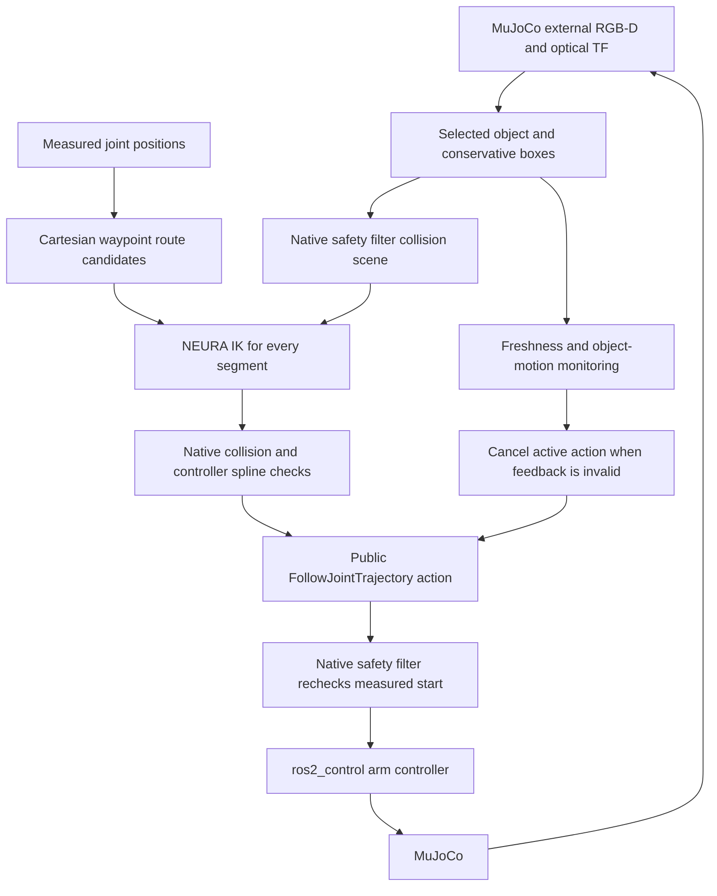

# Camera-guided trajectories and pick/place with NEURA IK (ROS 2 Humble)

For the independent approach task using an object pose from perception, use
[`lara5_object_approach`](../lara5_object_approach/README.md). Its single command
topic requires no camera feedback or obstacle routing and does not perform grasping.
The workflows below are the older, separate camera-based experiments.

**New pick-and-place workflow:** [complete setup, commands and architecture](PICK_AND_PLACE.md).
It uses external RGB-D localization, wrist-camera refinement, physical finger
closure, contact-verified lift, transfer, release and retreat. The divider obstacles
have been removed. Its grasp parameters are provisional and need simulation trials.
The sections below describe the separate `approach_object.py` noncontact client.

This simulation-only prototype uses **NEURA inverse kinematics for both the global
motion and the final approach**. It does not launch MoveIt or depend on its messages,
planners, collision scene or FK services. The default is **plan only**.

An external RGB-D camera locates a manually selected object. The arm travels to a
pre-approach pose, then descends 10 cm and stops without contact. The hand remains
open. Use the separate `pick_place.py` executable for wrist refinement and grasping.

## Architecture and ownership



The approach client owns route selection, timing, camera monitoring and action
dispatch. `lara5_safety_filter` owns NEURA FK/IK and the collision model. MuJoCo
owns physics and rendering. The same native collision model and its configured
clearance are used during planning, preview validation and command acceptance.
The current safety YAML requests **20 mm** minimum clearance. The pick/place
workflow permits intentional selected-object/hand contact only in explicit grasp
contexts; other collision pairs retain that limit.

### How global routing works

IK solves joint configurations for poses; a routing layer is still required to
find an alternative when a straight Cartesian path is blocked. The current layer
is deliberately bounded and suitable for simple tabletop scenes:

1. Freeze the measured six-joint starting configuration and obtain the flange
   pose from native NEURA forward kinematics.
2. Propose a direct Cartesian route to the pre-approach position.
3. Try four downward-facing flange yaw choices: 0, 90, 180 and -90 degrees,
   ordered by their orientation distance from the measured flange orientation.
4. If direct candidates fail, try raised routes and sideways routes. There are
   seven position routes in total: one direct, two raised and four sideways.
   Detours are ordered by their approximate Cartesian polyline length.
5. Solve each segment using `/safety/arm/plan_cartesian_path`. Each request starts
   at the preceding segment's solved joint configuration. For detours, the first
   lift preserves the measured orientation; subsequent motion turns toward the
   chosen goal orientation.
6. A failed IK solution, excessive joint jump, joint-limit violation or native
   clearance rejection discards that candidate. Partial routes are never sent.
7. Join the checked IK waypoints and retime them conservatively. Check interpolated
   controller positions, velocities and accelerations, then run the native path
   checker again. Also generate and check the final approach before accepting a
   global route. A blocked approach rejects the complete candidate.
8. Select the first fully valid route. Stop if all candidates fail, the attempt
   limit is reached, or the planning budget expires between candidate attempts.
   A service failure aborts planning rather than being treated as free space.

This is a finite Cartesian waypoint search. It is not a complete configuration-space
planner, and it does not guarantee the globally shortest path. It can reject a
scene even when a more complex route exists. Small obstacles may already be below
a clear direct arm route, so a visible detour is not guaranteed.

Every segment uses the existing native IK spacing and collision settings:
5 mm Cartesian spacing, 0.02 rad orientation spacing, 0.2 rad maximum native
joint jump, and joint-space collision checks at 0.02 rad resolution. The client
additionally rejects IK segment jumps over 0.15 rad while retiming.

### Timing and execution

The native service provides checked IK waypoints and its ordinary Cartesian
motion timing. This camera-guided client uses the waypoint geometry and applies
its own conservative cubic segment timing with zero endpoint velocities:

- Global route caps: 0.21 rad/s and 0.21 rad/s².
- Final approach caps: 0.12 rad/s and 0.25 rad/s².
- Position and velocity controller interpolation stays on each checked joint
  segment. The robot can pause at waypoints; this is not jerk-limited motion.

Both phases are previewed before execution. After global motion finishes, the
final approach is regenerated from **measured joints** and checked again. During
execution the client checks camera feedback approximately every 0.5 s. A stale
camera, missing object, changed hand posture or object-centre displacement over
2 cm requests cancellation. There is no automatic visual servoing or recovery.

All collision checks are discretely sampled, not a continuous swept-volume
proof. The safety filter models the hand as fixed in its open pose. Finger motion
and hardware execution are outside this prototype's scope.

### Interfaces

| Interface | Purpose |
| --- | --- |
| `/safety/arm/get_frame_pose` (`GetFramePose`) | Read-only NEURA FK from measured or explicit arm state, in a requested URDF reference frame |
| `/safety/arm/plan_cartesian_path` (`PlanCartesianPath`) | Generate and collision-check one complete NEURA IK segment without dispatch |
| `/safety/arm/check_trajectory` (`CheckTrajectory`) | Native joint-path validation from measured or explicit arm state |
| `/safety/arm/set_scene_boxes` (`SetSceneBoxes`) | Atomically replace camera-derived boxes in `world`, preserving configured static obstacles |
| `/arm_trajectory_controller/follow_joint_trajectory` | Execute through the native safety filter |
| `/safety/arm/move_to_pose` | Existing direct Cartesian execution action, still available |
| `/sim/planned_arm_trajectory` | Global trajectory preview, not a controller command |
| `/sim/approach_target` | Nominal pre-approach flange pose |

Scene replacement is disabled in ordinary controller bringup unless
`allow_scene_updates:=true`. The simulation launch enables it and forces
`safety:=on`. Scene changes during tracked active arm actions are rejected.
Run one motion client at a time and do not change hand posture during a run.

## Scene without divider obstacles

[obstacle_demo.yaml](config/obstacle_demo.yaml) now retains only the floor; the
two divider obstacles have been deleted. The old `obstacle_demo.launch.py` name
remains available for compatibility. The table, pedestal, robot and selectable
objects remain. `mujoco: false` avoids duplicating the existing floor plane.

The pick/place workflow uses `pick_place.launch.py`, which enables its explicit
simulation-only grasp scene service. The old launch keeps that service disabled.
Physics execution of the new grasp workflow has not been tested by the agent.

## Build and open the live simulation UI

Stop any previous simulation launch before starting the updated stack. Rebuild
because the code, service interfaces and obstacle dimensions have changed.

**Terminal A on the Linux desktop:**

```bash
cd /home/ercankacmaz/Documents/hackathon/neurahackathon
docker build -f src/docker/Dockerfile -t lara5_hackathon:neura-ik src
mkdir -p "$HOME/neurahackathon-data"
xhost +SI:localuser:root

docker run --rm -it --name lara5_neura_sim --ipc host \
  -e ROS_DOMAIN_ID=42 -e DISPLAY="$DISPLAY" \
  -e MUJOCO_GL=glfw -e LIBGL_ALWAYS_SOFTWARE=1 \
  --volume /tmp/.X11-unix:/tmp/.X11-unix:rw \
  --mount "type=bind,source=$HOME/neurahackathon-data,target=/data" \
  lara5_hackathon:neura-ik bash -lc \
  'source /opt/ros/humble/setup.bash && source /ws/install/setup.bash && ros2 launch lara5_sim_approach obstacle_demo.launch.py headless:=false'
```

Keep Terminal A and the MuJoCo window open. `DISPLAY` must be nonempty and the
host must support X11 or XWayland. The launch always selects the simulated hardware.
It starts native trajectory services and the camera; there is no MoveIt process.

For the plain scene, launch `camera_approach.launch.py headless:=false` instead.
For headless operation, use `headless:=true` and `MUJOCO_GL=osmesa`.

## Select an object, plan, then execute

**Terminal B:**

```bash
docker exec -it lara5_neura_sim bash
source /opt/ros/humble/setup.bash
source /ws/install/setup.bash
OBSTACLES=/ws/install/lara5_sim_approach/share/lara5_sim_approach/config/obstacle_demo.yaml

ros2 control list_controllers
ros2 service list
```

The arm controller, hand controller and joint-state broadcaster should be active.
Check for `/safety/arm/get_frame_pose` and `/safety/arm/plan_cartesian_path`.
If the new FK service is missing, the running container is using an older image.

Plan without moving:

```bash
ros2 run lara5_sim_approach approach_object.py --ros-args \
  -p object_name:=red_cube -p execute:=false \
  -p obstacles_file:="$OBSTACLES" \
  -p output_file:=/data/red_neura_plan.json
```

Available names are `red_cube`, `green_cylinder` and `blue_ball`. All three
configured objects must be confidently visible. Successful planning logs:

```text
Planning global motion with NEURA IK Cartesian waypoint routing
NEURA IK accepted route ...; global motion and final approach both validated
Both phases planned; saved /data/red_neura_plan.json
```

After plan-only succeeds, watch the MuJoCo window while running:

```bash
ros2 run lara5_sim_approach approach_object.py --ros-args \
  -p object_name:=red_cube -p execute:=true \
  -p obstacles_file:="$OBSTACLES" \
  -p output_file:=/data/red_neura_executed.json
```

Both visible phases now use NEURA IK:

```text
Executing NEURA IK global route in simulation
Executing NEURA IK Cartesian noncontact approach
```

The flange stops approximately 0.35 m above the observed object top, with the
pre-approach pose another 0.10 m higher. This clearance is measured at the flange;
the fingers extend below it. The hand never closes. Execution replans from current
joints rather than replaying a saved JSON file.

Reports are saved under `$HOME/neurahackathon-data` on the host. They include
`global_planner: "NEURA IK Cartesian waypoint routing"`, `approach_planner:
"NEURA IK"`, `selected_route`, camera target, timed phase waypoints and measured
final flange error on successful execution.

### Parameters for route tuning

| Client parameter | Default | Meaning |
| --- | --- | --- |
| `route_attempts` | `28` | Maximum route/yaw candidates; seven position routes times four yaw choices |
| `planning_timeout` | `30.0` s | Planning budget checked between candidate attempts; an in-flight service call has its own timeout |
| `lift_step` | `0.08` m | Raised routes use one or two increments above the higher endpoint |
| `detour_margin` | `0.12` m | Sideways waypoint offset outside the start/goal XY bounds |
| `flange_clearance` | `0.35` m | Final flange height above the observed object; minimum allowed is 0.30 m |
| `preapproach_distance` | `0.10` m | Final downward approach distance |
| `freshness` | `2.0` s | Maximum age for camera and robot feedback |

For example, add `-p detour_margin:=0.16 -p route_attempts:=28` to a client command.
Changing the IK path proposals never bypasses the native clearance check. If no
route succeeds, the client reports the last rejection and sends no arm goal.
For individual candidate reasons, add `--log-level debug` after `--ros-args`.

To examine filter status, open another sourced container shell and run
`ros2 topic echo /safety/status`, then repeat the failing command. A
`Safety filter rejected trajectory preview` message still prevents execution.
Do not reduce `min_distance` merely to make a rejected trajectory execute.

## Direct native Cartesian movement

After the approach finishes, a small upward movement can be tested independently:

```bash
ros2 run lara5_controller_manager move_cartesian.py --frame world --z 0.05 --duration 4
```

After it finishes, return by the same amount:

```bash
ros2 run lara5_controller_manager move_cartesian.py --frame world --z -0.05 --duration 4
```

These commands use native NEURA IK and the filter's existing action. They do not
include the approach client's camera-monitoring loop. The direct client does not
cancel on Ctrl+C; wait for these short movements to finish.

## Camera feedback

The ideal external RGB-D camera (hardware target: RealSense D435) is configured in
[mujoco_sim.yaml](../lara5_mujoco_sim/config/mujoco_sim.yaml). It is fixed at
`[-1.25, 1.50, 2.10]`, looking at `[-0.25, 0.10, 1.15]`, with 640×480 resolution,
60-degree vertical field of view and a requested 10 Hz rate.

| Topic | Format |
| --- | --- |
| `/sim/external_camera/color/image_raw` | `rgb8` |
| `/sim/external_camera/depth/image_raw` | `32FC1` optical-axis depth in metres |
| `/sim/external_camera/camera_info` | Ideal pinhole calibration |
| `/tf_static` | `world` to `sim_external_camera_optical_frame` |

RGB, depth and intrinsics share a capture timestamp. The client transforms the
points into `world`. Runtime localization uses image pixels and known colour/size
priors, never configured object positions or MuJoCo body poses. It supports the
known upright, distinctly coloured props, not arbitrary obstacle reconstruction
or duplicate-colour object identification. Replace this adapter with the
perception team's object IDs, poses, geometry and uncertainty later.

Camera rendering uses a copied physics state in another thread. ROS timestamps
follow the existing wall-clock convention; no `/clock` or `use_sim_time` is added.
Moving the UI viewing angle does not change the fixed external camera.

A second simulated D435 is mounted near the wrist and aimed along the inside of
the open hand. It publishes RGB, depth and CameraInfo under `/sim/wrist_camera`,
with `sim_wrist_camera_optical_frame` attached to `right_hand_base_link`. Its mount
is provisional and configurable. The approach client continues to use the external
camera. See the [camera setup and live wrist-view instructions](../lara5_mujoco_sim/README.md)
for mounting parameters, TF conventions, calibration limits and grasping integration.

## Shutdown and reset

Ctrl+C in Terminal B requests cancellation of an active approach. Ctrl+C in
Terminal A shuts down the simulation. Revoke display access on the host afterward:

```bash
xhost -SI:localuser:root
```

Restarting the container resets the robot and objects for a comparable test.
After changing fixture geometry, rebuild/recreate the container and keep the same
`obstacles_file` in launch and client commands. If changing the prop/camera config,
pass the same file to launch (`sim_config:=...`) and client (`-p config_file:=...`).

## Validation

The following geometry/policy tests run on the host without ROS or simulation:

```bash
PYTHONPATH=src/robot/lara5_sim_approach python3 -m unittest discover \
  -s src/robot/lara5_sim_approach/test -p test_routing.py -v
PYTHONPATH=src/robot/lara5_mujoco_sim python3 -m unittest discover \
  -s src/robot/lara5_mujoco_sim/test -p test_static_obstacles.py -v
```

They check direct-route priority, detour endpoints, rejection/fallback, bounded
attempts, planning timeouts, service failures, invalid parameters, obstacle sizes,
rotations and shared configuration. They do not validate robot reachability.

Additional tests inside the rebuilt Humble image are available for later testing:

```bash
python3 -m pytest -q /ws/src/robot/lara5_sim_approach/test/test_feedback.py
```

That test renders and steps MuJoCo; it should only be run when simulation is
allowed. The opt-in live tests below require an isolated running launch and move
the simulated arm. They check blocked native goals, FK/IK preview, scene replacement
and cancellation; do not run another motion client concurrently:

```bash
LARA5_LIVE_TEST=1 python3 -m pytest -q \
  /ws/src/robot/lara5_sim_approach/test/test_live_workflow.py
```
